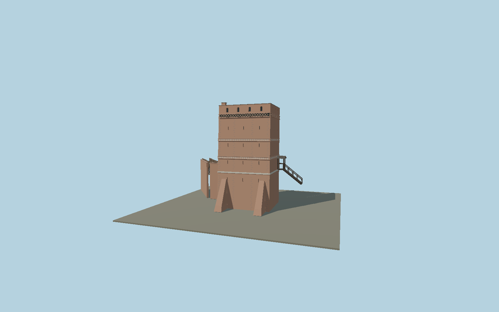

# Leaning Tower of Toruń

Leaning medieval brick tower with the asymmetric jettied timber north wall, measured floor tiers, slit windows and Gothic friezes, zinc shed roof, south buttresses, west garderobe and gallery, and the roofed east timber stair.

## Identity and geometry

Catalog leaning_tower_of_torun, [Q2234463](https://www.wikidata.org/wiki/Q2234463). The municipal 2019 restoration record supplies plans, section, north elevation and photographs of every exterior. The exact-identity OSM outline establishes its horizontal frame; the section supplies the floor levels and roof slope. Published street/slope height descriptions refer to different ground levels: the visible southern base is preserved below the north street. The 1.46 m northward lean is applied above that street reference, with continuation through the exposed basement.

Mapped tower footprint center at north street level in plan; Y=0 is the exposed south-slope foundation, with north street at Y=4 m. +Z faces the Vistula-side south brick elevation; the half-timbered entrance is on -Z toward the town; +Y is up. The geographic proposal identifies its anchor and orientation evidence separately from remaining terrain and azimuth uncertainty.

Source facts and measured references are recorded in spec.json. References: [1](https://bip.tak.torun.pl/bip_att.php?id=749), [2](https://zabytek.pl/pl/obiekty/torun-baszta-miejska-tzw-krzywa-wieza), [3](https://visittorun.com/en/node/53), [4](https://www.openstreetmap.org/way/81882855). Reference pages and images are not redistributed.

## Original source and shared materials

Geometry is authored in `packages/worldgen/scripts/torun-leaning-tower-model.mjs`. Shared material graphs with metric repeat UV0 and original vertex tints; GLB PBR fallback remains self-contained. No per-model texture duplication. No third-party mesh or photograph is embedded.

45,782 triangles; 99,758 vertices; 6 material groups; 4,144,396 source bytes. Source hash: `sha256:c5c86fdcafa19a24c65d1a76be3550aba29d05dcbde8a48f3c3fba07e6944789`. Geometry validation checks finite Float32 coordinates, indices, triangle area and winding before export.

Regenerate with `node packages/worldgen/scripts/generate-heritage-towers.mjs leaning_tower_of_torun`; add `--check` for reproducibility. The generator refuses to overwrite a master whose hash differs from source.json. Import uses `--no-optimize` to preserve facade recesses.

## Remaining detail and review

- Complete static medium-fi exterior of the surviving Leaning Tower of Toruń: three brick faces, northward lean, jettied half-timbered north facade with windows and door, slits and upper arched apertures, two painted bands and upper Gothic frieze, zinc shed roof/chimney, southern buttresses, west quarter-round garderobe and attached bent gallery, east covered landing and timber stair. The original municipal-record-based45782triangle master remains byte-reproducible and is retained at closeup. Four budgeted whole-building levels simplify small frieze lobes, individual brick repairs, roof seams, gallery boards and joinery. The source follows published2019 plans/section and original exterior photographs, not a complete restoration survey. The northern street/door and eastern stair foot use sourceY4, while the exposed southern base isY0. A separate north-street terrain reference anchors that known height, and the source-local grade fixture reconstructs the4m relative retaining/slope profile to check contact; it is a simplified interpretation, not a measured DEM or absolute elevation. Host terrain must retain local grade. The plan registration and decorative/window offsets remain approximate within2m position and5° heading. Original19.6m height includes chimney; published12/19m descriptions use different faces/datums. No visitor interior, neighboring buildings, whole city-wall network, vegetation, downloaded mesh or photographic texture is included. Common shared material graphs approximate mixed historic brick bonds rather than duplicating site-specific maps. Physical phone/laptop timings and live host terrain fidelity remain unmeasured.

Named near/far cameras are included for lit visual review. A valid export is not maximum-fidelity certification.
