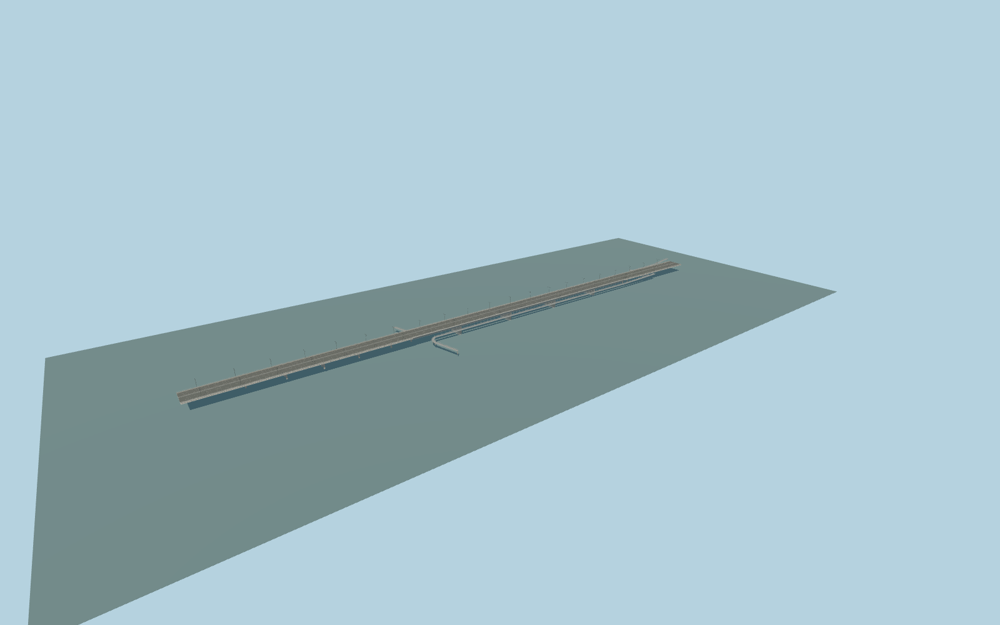

# Łazienkowski Bridge

Pale five-span four-girder Vistula road bridge, six lanes, concrete river piers and asymmetric land viaducts; twin lower pedestrian/cycle paths with signed curved bank accesses and repeated slender road lamps.

Source: deterministic models/lazienkowski-model.mjs and alignment.json, ordinary linked pictures and standard viewer PMTiles/terrain inputs. Shared materials come from the central256px graph library. Rebuild with `node packages/worldgen/scripts/generate-lazienkowski-bridge.mjs`; append `--check` for exact-byte verification. Import/build browser levels with the normal targeted scripts and `--ids=azienkowski_bridge`. GLBs are ignored outputs.

The423m five-span river unit is distinct from the860m modeled road viaduct and its lower signed cycle/path ramps. Native origin approximates74m sea-level; bank/approach/footpath heights and foundations remain reconstructed. See model-brief.json for explicit limitations and qa.json for current acceptance.

Original geometry uses the repository license. Map-derived controls: © OpenStreetMap contributors, ODbL-1.0;Protomaps basemap. Standard terrain attribution remains in terrain-samples.json. Reference photographs are linked, not redistributed or used as textures.
