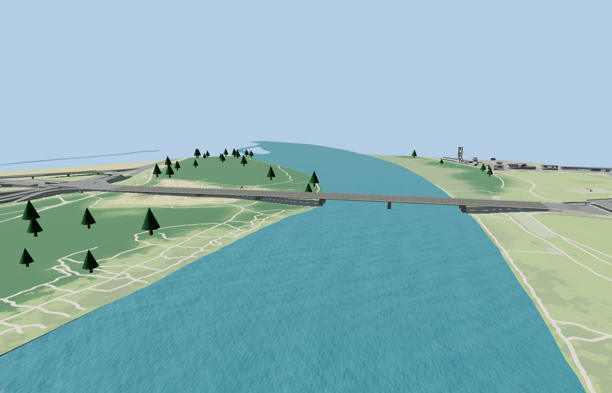

# Grot-Rowecki Bridge

Two parallel concrete box-girder decks carry four carriageways across the Vistula. Dark steel brackets support the widened wings and outside walking and cycling paths. Repeating paired columns, shallow profile, and a narrow median slot carry the silhouette.

The named OSM bridge way 368093110 and the four PMTiles carriageways and two path traces place the deck across the Vistula northeast from Bielany. A 0.75 m overlap at each bearing joins the retained map approaches. Road steps are below 2 cm. The paths retain a curb of about 8 cm. The original crossing returns when the model fails to load. Native terrain, water, approach ramps and lower paths remain.

The 42,232-triangle source rebuilds byte for byte. The first two runtime tiers total 340,892 bytes. Six GLBs validated and 36 current views were inspected.

The exact mapped deck outline and six transport traces fix the crossing frame and width. Pier stations, steel sections, rail spacing and heights are exterior-photo approximations. The main deck and widened side wings reflect the post-expansion appearance. Connecting ramps, approaches and lower paths remain separate map context.

Rebuild with `node packages/worldgen/scripts/generate-grot-rowecki-bridge.mjs`. Append `--check` to compare exact bytes. Use `--ids=general_stefan_grot_rowecki_bridge` for targeted import, LOD, placement and readiness.
