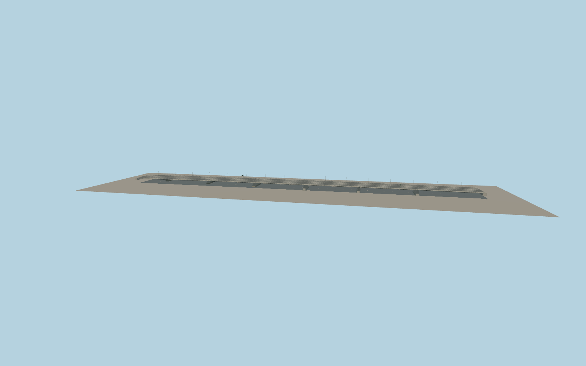

# Grot-Rowecki Bridge

Two parallel concrete box-girder decks carry four carriageways across the Vistula. Dark steel brackets support the widened wings and outside walking and cycling paths. Repeating paired columns, shallow profile, and a narrow median slot carry the silhouette.

Run `node packages/worldgen/scripts/generate-grot-rowecki-bridge.mjs` to rebuild the source master. Append `--check` to compare the exact bytes. Use `--ids=general_stefan_grot_rowecki_bridge` for targeted import, LOD generation and placement.

The exact mapped deck outline and six transport traces fix the crossing frame and width. Pier stations, steel sections, rail spacing and heights are exterior-photo approximations.

The main deck and widened side wings reflect the post-expansion appearance. Connecting ramps, approaches and lower paths remain separate map context.

Original geometry follows the repository license. Map data is © OpenStreetMap contributors under ODbL-1.0 via Protomaps. Terrain samples are described in terrain-grid.json. Ordinary pictures stay local and are not redistributed or used as textures. Current acceptance is recorded in qa.json.
