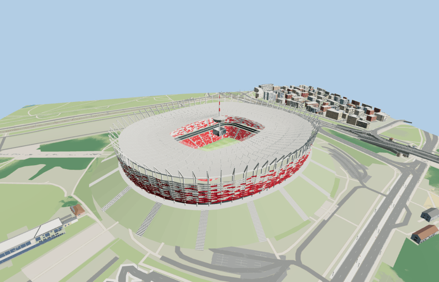

# Warsaw National Stadium

The red-and-white façade, raised berm, open membrane roof and central mast identify Warsaw’s National Stadium at all four viewer distances. Closer models add the approach steps, two seating tiers and hospitality ribbons, roof glazing and radial cables, suspended scoreboard and the expanded-metal façade.

The signed roof axis faces northwest. The southwest street sample sets the approximate datum near 86.01 m. The pitch sits about 8.1 m and the main concourse about 18 m above that datum. The viewer replaces 698 native stadium component records, retaining all 182 independent building records and 686 roads and rail records in the fixture.

| Detail level | Triangles | Download bytes | Draws |
| --- | ---: | ---: | ---: |
| skyline | 970 | 80,512 | 6 |
| district | 2,814 | 219,640 | 6 |
| street | 13,794 | 1,056,668 | 7 |
| closeup | 63,090 | 4,715,700 | 8 |

The source rebuild reproduces the original 1,388,718 triangles byte for byte. The first two browser tiers total 300,152 bytes. All four browser models use shared materials and contain zero embedded images. The source and portable runtime each carry one 3,164-byte mask baked from the shared expanded-metal graph.

A failed model load retains the mapped stadium. All four tiers release their geometry on unload. The review covers 61 captures and 100 placement samples.

The public elevation tiles give approximate street and berm contact. Cable sag, seats and the color distribution of the mesh panels are reconstructed from photographs.

The permanent exterior and visible bowl include the operable roof parked over the center. Roof movement, enclosed rooms and event signage are outside the modeled scope.

[Architect photographs](https://www.gmp.de/en/projects/519/national-stadium-in-warsaw) · [Mapped terrain fit](site-fit.json) · [QA evidence](qa.json)
