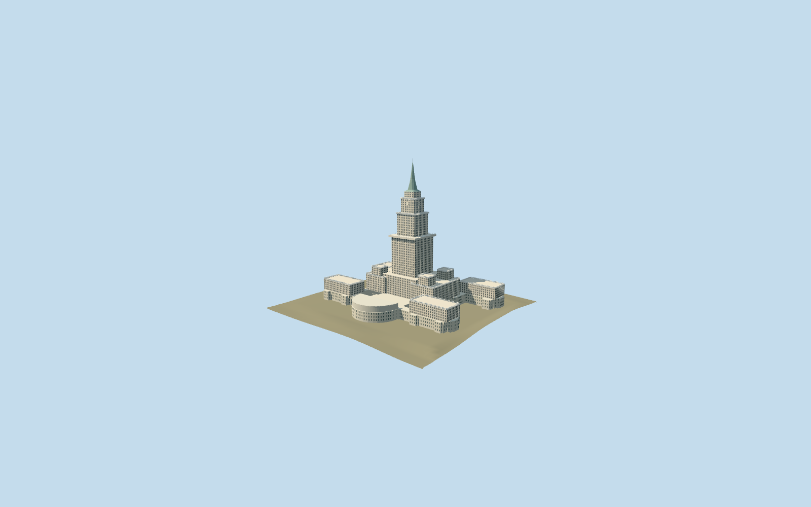

# Palace of Culture and Science

Budgeted Palace of Culture complex preserves both courtyard openings, ceremonial eastern portico, low wings, central terrace/clock shaft and rounded Congress Hall. Far tiers merge windows, crenellations and unseen bottoms; original detailed source remains reproducible.

## Evidence and reconstruction

Published dimensions and reconstructed details are separated in spec.json. Primary references:

- [Reference](https://pkin.pl/informacje-o-pkin/)
- [Reference](https://pkin.pl/galeria-zdjec/)
- [Reference](https://www.openstreetmap.org/relation/1319250)

No third-party geometry, photograph or bitmap texture is embedded. Shared surface graphs come from the central library; vertex tints carry model colors. Glazing uses PBR materials; transparent surfaces are declared per model.

## Model and axes

63,782 triangles; 191,346 vertices; 4 material groups; 7,656,544 bytes. Native bounds: -133.670, 0.000, -108.096 to 133.679, 237.000, 108.031. Source hash: `sha256:6b9c2cce91eb767927b66630f040edae5c7ea559b26797079beea1b9984119b0`.

{"up":"+Y","longitudinal":"+X along the mapped building long axis","front":"Native-Z ceremonial entrance; Congress Hall at native+Z","origin":"Ground-level center of exact-QID mapped footprint frame"}

One inspected operator exterior detail photograph establishes the warm stone upper shaft, pale clock faces and ornamental terrace/crowns. The original237m height,114m terrace, stepped tower, low complex wings, eastern portico, two courtyard holes and rounded Congress Hall remain authored/mapped controls. Retain the exact-QID concave relation and signed frame; native-Z points toward the eastern entrance and Congress Hall remains at native+Z. Standard viewer PMTiles confirms the complex and road context. Off-footprint PMTiles[-150,0]115.0133m sets approximate terrain contact; center124.8438m contains coarse urban imprint. Rectangular preview correction covers the full complex with raw heights kept separately. Exact sculpture, ceramic ornament, mermaid emblems, window schedule, interior halls and threshold elevations remain approximations or excluded. The cropped picture does not certify the whole low-wing layout; existing mapped controls are retained.

## Reproduce

Run `node packages/worldgen/scripts/generate-signature-towers.mjs --ids=N0146` (or add `--check`). The generator preserves manually edited masters by checking their baseline hashes. Import through the standard authored-model workflow with optimization disabled; then capture all QA cameras, including shared-surface views.

## Pending work

- One inspected operator exterior detail photograph establishes the warm stone upper shaft, pale clock faces and ornamental terrace/crowns. The original237m height,114m terrace, stepped tower, low complex wings, eastern portico, two courtyard holes and rounded Congress Hall remain authored/mapped controls. Retain the exact-QID concave relation and signed frame; native-Z points toward the eastern entrance and Congress Hall remains at native+Z. Standard viewer PMTiles confirms the complex and road context. Off-footprint PMTiles[-150,0]115.0133m sets approximate terrain contact; center124.8438m contains coarse urban imprint. Rectangular preview correction covers the full complex with raw heights kept separately. Exact sculpture, ceramic ornament, mermaid emblems, window schedule, interior halls and threshold elevations remain approximations or excluded. The cropped picture does not certify the whole low-wing layout; existing mapped controls are retained.
- Two common granite/painted-metal graphs with opaque glass/dial PBR and no copied imagery. Far perimeter simplification is bounded to3m and courtyard contours remain separate; low tiers merge decorative crowns and omit clock hands/unseen bottom faces. Closer tiers restore window/sill impressions, individual merlons, clock hands and portico columns. Physical-device timings pending.

This bundle follows the medium-fi standard. Medium-fi appearance and geographic fit are reviewed separately. Hash-bound visual acceptance is recorded separately after capture inspection.
