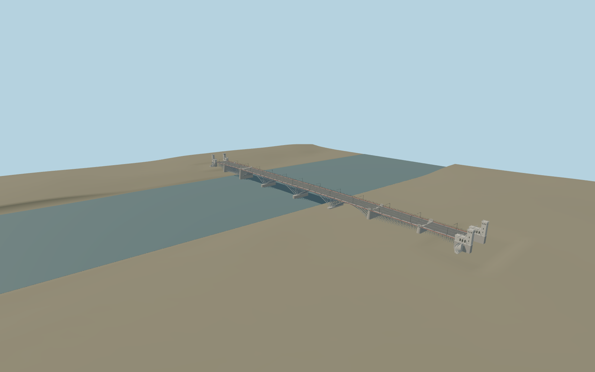

# Poniatowski Bridge

Independent compact river bridge: mixed steel spans, seven cutwater piers, tall pylons, heraldic bench impressions, four Renaissance towers and curved stairs, iron rail, tram tracks and wires. Original detailed master preserved.

## Evidence

- [Primary reference](https://commons.wikimedia.org/wiki/Category:Most_i_wiadukt_imienia_ks._J%C3%B3zefa_Poniatowskiego_przez_rzek%C4%99_Wis%C5%82%C4%99_w_Warszawie_(1927))
- [Primary reference](https://mbc.cyfrowemazowsze.pl/Content/83246/PDF/00090666_-_Zycie-Srodmiescia-bezpl-2021-nr-6-43-czerwiec-_-.pdf)
- [Primary reference](https://commons.wikimedia.org/wiki/File:Most_Poniatowskiego_w_Warszawie_2021.jpg)
- [Primary reference](https://bedeker.waw.pl/index.php/2020/07/18/most-ksiecia-jozefa-poniatowskiego-plaskorzezby/)
- [Primary reference](https://www.warszawa1939.pl/galeria-powiazany/most-poniatowskiego-f/galeria-powiazana-1960-kartusze-zdobiace-most)
- [Primary reference](https://www.openstreetmap.org/way/368095449)

Published dimensions and reconstruction assumptions are separated in spec.json. Source photos were consulted; no photos or third-party geometry are embedded. Map plan attribution: © OpenStreetMap contributors, ODbL-1.0.

## Source

63380 triangles; 7608880 bytes; 5 material groups. SHA256: sha256:8d08cd0f4c7e56683b6d545d0840c29ea3b86fe2cf2cd71e481cb15eeaf2191c.

Shared surfaces (concrete_plain, metal_painted, stone_granite, stone_limestone_raw) are loaded through the central library; any transparent materials use local PBR parameters. Axis and provisional vertical datum are in spec.json.

Regenerate with node packages/worldgen/scripts/generate-researched-bridges.mjs --ids=poniatowski_bridge; append --check to verify. Import and capture through the standard structure-catalog scripts. Geometry validation does not substitute for current-frame visual review.

## Reconstruction limits

- Inspected current upstream bridge picture: four rebuilt central arches, outer N-trusses, red fascia, tall stone pylons and lower central caps. Retained directed OSM controls place the503.74m river deck, seven piers, four bank towers and curved stairs at their existing positions; published506.13m is a separate nominal definition. Standard viewer PMTiles confirms the Vistula crossing and bank context. Use coarse river-center74.0063m as approximate runtime origin; original77m engineering reconstruction and its native road profile remain preserved without a asserted datum conversion. Bounded river opening and source-local water/bank contacts remove coarse DEM imprint. Road deck levels and stair contacts are approximate; separate701m western approach, exact heraldry/casting, bathymetry and survey joins are excluded.
- Four shared material graphs reused; silhouette level bakes their means. Closer levels restore seven ribs, ornate rail impressions, windows, crown crests, stairs and shield benches. Exact emblems, curls, individual stone joints and rivets remain in the original master. No new bespoke terrain research. Physical-device timings unmeasured.
