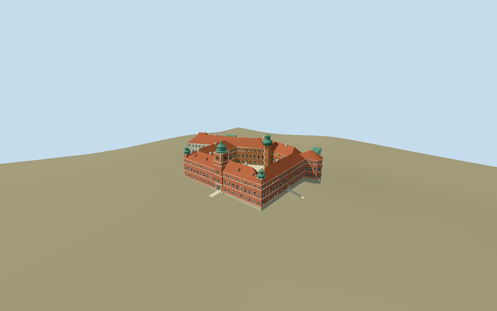

# Royal Castle in Warsaw

Mapped five-wing palace and courtyard, red Castle Square facade, pale river pavilions, Clock Tower, corner turrets and Wladyslaw courtyard tower. Present-day reconstructed exterior with tiled roofs and patinated copper crowns.

## Evidence and reconstruction

Published dimensions and reconstructed details are separated in spec.json. Primary references:

- [Reference](https://biuroprasowe.zamek-krolewski.pl/en/presskit/category/28345)
- [Reference](https://www.zamek-krolewski.pl/strona/historia/603-zamek-wazow-i-krolow-rodakow-1587-1696)
- [Reference](https://zamek-krolewski.pl/en/strona/accessibility/2508-description-architectural-accessibility-royal-castle)
- [Reference](https://www.openstreetmap.org/relation/64436)

No third-party geometry, photograph or bitmap texture is embedded. Shared surface graphs come from the central library; vertex tints carry model colors. Glazing uses PBR materials; transparent surfaces are declared per model.

## Model and axes

25,983 triangles; 54,985 vertices; 6 material groups; 2,295,000 bytes. Native bounds: -98.456, -13.953, -98.544 to 59.650, 47.412, 60.800. Source hash: `sha256:81e8ef1c55fc2bbc1028b4ba5e55982157a264d1ca79b2d64dfe467dc183ac38`.

{"up":"+Y","longitudinal":"+X south along city facade","front":"+Z west toward Castle Square","origin":"Signed mapped palace anchor; Y0 decoded106.7541 m working datum."}

Fresh exact-QID relation64436 v49 and outer/inner ways retain palace/court identity. Original indexed outer corners differ up to3.634070 m and courtyard corners up to0.222802 m from current vertices; independent reviewed-plan.json uses reconciled fresh corners while legacy map-frame geometry remains unchanged to reproduce the original master. Anchor[21.014829838,52.247715277], heading-1.6320593581624288: +X south-southwest183.510113 degrees, +Z west-northwest273.510113 degrees into Castle Square. Clock Gate +Z, Vistula facade -Z; Grodzka entrance fresh node4962090530 native[43.58025,8.68491], Clock Gate node4962090528[0.17828,50.76714]. Museum photos and two-entry accessibility text sign these controls. Retained16641-value4 m terrain grid has working datum106.7541 m;2.924905 m pixel interval is not verified native resolution or survey accuracy. Rigid palace/library floor2.2125 m uses maximum occupied decoded sample plus0.25 m; buried foundation ends-13.9531 m. Model-only bounded masonry plinth and reconstructed short sloping portal aprons retain host ground. Escarpment, native court/library levels, datum/vintage and under-building contamination remain unverified. No city, river or garden terrain replacement.

## Reproduce

Run `node packages/worldgen/scripts/generate-signature-towers.mjs --ids=royal_castle_in_warsaw` (or add `--check`). The generator preserves manually edited masters by checking their baseline hashes. Import through the standard authored-model workflow with optimization disabled; then capture all QA cameras, including shared-surface views.

## Pending work

- Original27495-triangle/2406004-byte master reproduces at sha256:098fc682a3c9db2045c141d0331b88d51144ed2007d9b8188ed5c24b9924c852 from unchanged warsaw-royal-castle-model.mjs#buildWarsawRuntime and unchanged legacy map-frame.geometry.
- Fresh exact-QID relation64436 v49 and outer/inner ways retain palace/court identity. Original indexed outer corners differ up to3.634070 m and courtyard corners up to0.222802 m from current vertices; independent reviewed-plan.json uses reconciled fresh corners while legacy map-frame geometry remains unchanged to reproduce the original master. Anchor[21.014829838,52.247715277], heading-1.6320593581624288: +X south-southwest183.510113 degrees, +Z west-northwest273.510113 degrees into Castle Square. Clock Gate +Z, Vistula facade -Z; Grodzka entrance fresh node4962090530 native[43.58025,8.68491], Clock Gate node4962090528[0.17828,50.76714]. Museum photos and two-entry accessibility text sign these controls. Retained16641-value4 m terrain grid has working datum106.7541 m;2.924905 m pixel interval is not verified native resolution or survey accuracy. Rigid palace/library floor2.2125 m uses maximum occupied decoded sample plus0.25 m; buried foundation ends-13.9531 m. Model-only bounded masonry plinth and reconstructed short sloping portal aprons retain host ground. Escarpment, native court/library levels, datum/vintage and under-building contamination remain unverified. No city, river or garden terrain replacement.
- Four-meter diagnostic grid resamples public terrain;2.924905 m pixel interval is not verified native resolution or surveyed accuracy. Datum/vintage/under-building contamination unknown; no outlier filter.
- Maximum occupied mapped palace/library sample plus0.25 m sets rigid floor. Foundations extend two meters beneath minimum occupied sample. City/terrace foundation levels and library height remain interpretations, not measured escarpment or archaeological levels.
- Host ground retained outside and beneath bounded palace plinth; no city/river/garden terrain replacement. Kubicki Arcades and the upper/lower terrace landscape are excluded.
- Accepted medium-fi reconstructed present-day palace/library exterior: five wings, roofless court, red city elevation, Clock Tower/two corner crowns, projecting Wladyslaw tower/Gothic brick wall and pale river pavilions. Fresh mapped corners adjust city/south-wing and courtyard plans; small collinear steps are simplified. Clock and Grodzka Gates are modeled as open passages; Senators doorway and river arched openings are opaque facade reserves. These are not modeled rooms or a navigable museum.
- Primary museum history states a40 m historical Clock Tower; present45.2 m finial,19.2 m main eaves/27 m ridges,36 m courtyard tower and30 m corner crowns remain photographic estimates, not current measured dimensions. Library8.6 m eave/10.5 m roof and foundation/entrance-apron levels are reconstructed. Gothic pointed blind bays, window positions, copper profiles, clock/crest/sculpture and roof detail are abstracted. No exact2026 daily-condition survey; temporary plants/exhibits/furniture excluded.
- Kubicki Arcades, garden retaining walls/terraces, upper/lower landscape, Tin-Roofed Palace and neighboring town buildings are outside scope. No claim whole museum campus is modeled.
- Five common graphs provide lime plaster, limestone, ceramic roof tile, patinated copper and Gothic brick. Local opaque PBR group provides glazing and dark opening reserves. Skyline bakes actual common linear means. No per-model photographic images; physical laptop/phone timings pending.

This bundle follows the medium-fi standard. Medium-fi appearance and geographic fit are reviewed separately. Hash-bound visual acceptance is recorded separately after capture inspection.

## Additional geographic data

Footprint © OpenStreetMap contributors, ODbL-1.0. Museum photographs are linked visual evidence only; no third-party images or meshes are redistributed.
