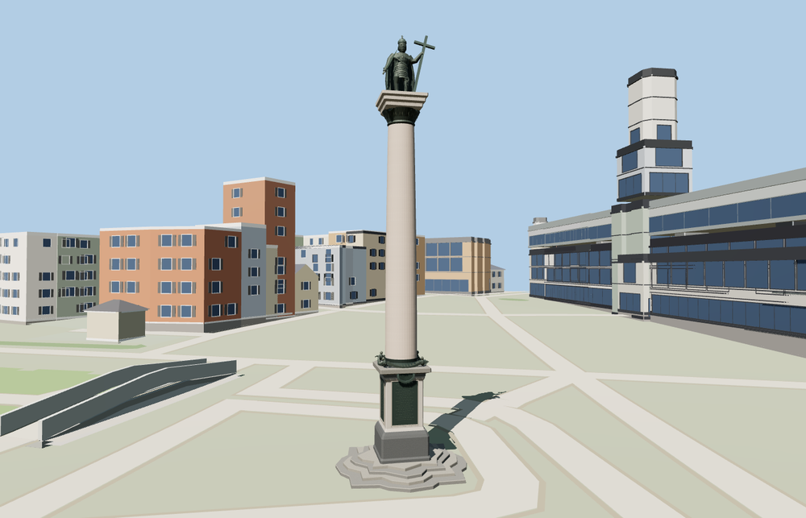

# Sigismund’s Column

Sigismund’s Column in Warsaw with the mapped scalloped steps, inscribed granite pedestal, pink shaft, bronze Corinthian capital and the crowned king holding a cross and sword.

The 14,165-triangle source rebuilds byte for byte. Skyline, district, street and close-up use 994, 3,529, 7,403, 12,813 triangles. The first two tiers total 370,704 bytes. Six GLBs validated and 38 current views were inspected.

All four tiers pass eight ground contacts, four shaft diameter probes and silhouette probes at the cross, sword, face and boots. The viewer retains 172 independent buildings, 204 mapped road parts and Castle Square. Failed loading restores the eleven original monument features.

The eleven mapped components set the principal proportions. The signed face and statue pose follow the exterior photographs. Fine facial features, heraldic relief and fabric folds are reconstructed approximations. The plaque lettering is represented by incised line fields. The Castle Square paving, surrounding buildings and underground routes stay in their native viewer layers. Physical-device timings are unmeasured. The procedural fallback draws the mapped capital as a detached slab.

Rebuild with `node packages/worldgen/scripts/generate-sigismunds-column.mjs`. Append `--check` to compare exact bytes. Use `--ids=sigismunds_column` for targeted import, LOD, placement and readiness.
