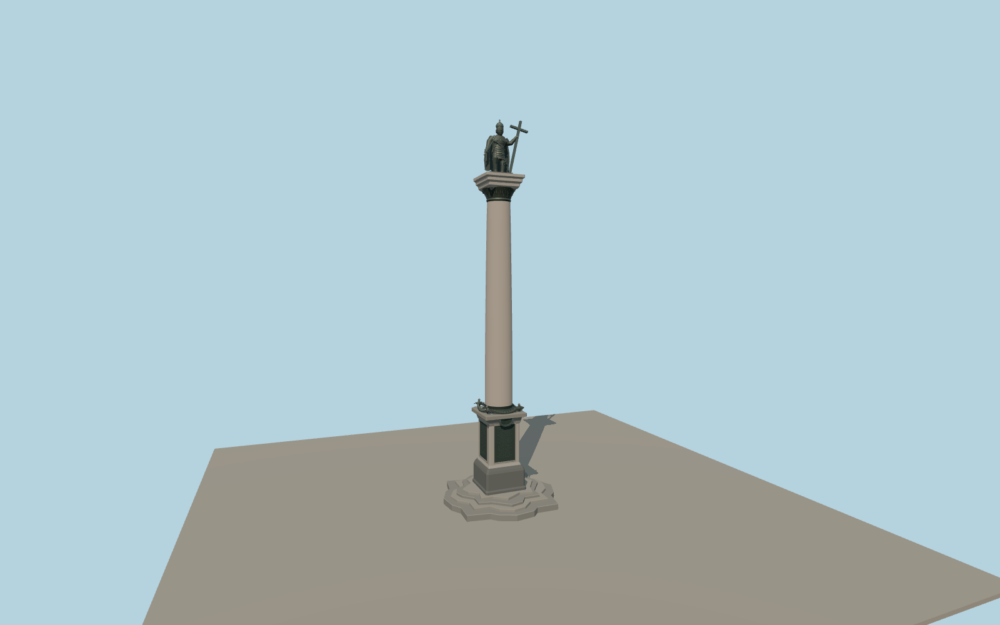

# Sigismund’s Column

Sigismund’s Column in Warsaw with the mapped scalloped steps, inscribed granite pedestal, pink shaft, bronze Corinthian capital and the crowned king holding a cross and sword.

Run `node packages/worldgen/scripts/generate-sigismunds-column.mjs` to rebuild the source master. Append `--check` to compare the exact bytes. Use `--ids=sigismunds_column` for targeted import, LOD generation and placement.

The eleven mapped components set the principal proportions. The signed face and statue pose follow the exterior photographs. Fine facial features, heraldic relief and fabric folds are reconstructed approximations.

The plaque lettering is represented by incised line fields. The Castle Square paving, surrounding buildings and underground routes stay in their native viewer layers.

Original geometry follows the repository license. Map data is © OpenStreetMap contributors under ODbL-1.0 via Protomaps. Terrain samples are described in terrain-grid.json. Ordinary pictures stay local and are not redistributed or used as textures. Current acceptance:qa.json.
