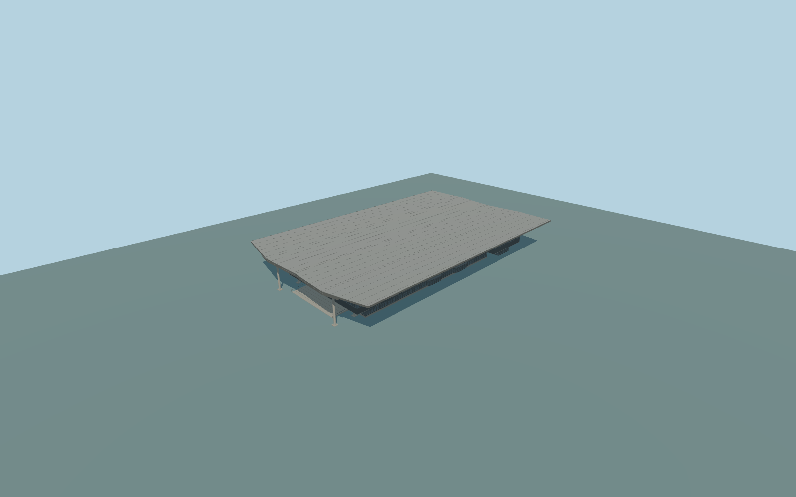

# Warsaw Central railway station

Complete permanent aboveground Warsaw Central passenger ensemble: full bowed metal cantilever roof and lower soffit shell,both end/mezzanine/clerestory ranges,central glazed hall,closed lower entrance footprint,all28 mapped tall pillars,west entrance stairs andtwo north-side open low canopies. Preserve the independent Zlote Tarasy mall,bridges/service buildings,office/hotel towers,streets,rail/tunnels andsurrounding small kiosks. Exterior only;no copied signs,lettering,brands,people,trains or navigable underground platforms/interior.

Rebuild: `node packages/worldgen/scripts/generate-warsaw-central-railway-station.mjs`;append `--check` for exact source bytes. Select import/LOD/placement with `--ids=warsaw_central_railway_station`. Detailed source and four browser tiers are separate ignored GLB outputs.

Complete permanent aboveground Warsaw Central passenger ensemble: full bowed metal cantilever roof and lower soffit shell,both end/mezzanine/clerestory ranges,central glazed hall,closed lower entrance footprint,all28 mapped tall pillars,west entrance stairs andtwo north-side open low canopies. Preserve the independent Zlote Tarasy mall,bridges/service buildings,office/hotel towers,streets,rail/tunnels andsurrounding small kiosks. Exterior only;no copied signs,lettering,brands,people,trains or navigable underground platforms/interior.

Numeric source heights retained explicitly. Use the18m upper/16.5m lower roof stacks as curved shells and28 fifteen-metre supports,not parent-wide solid boxes. Actual lower hall floor+.65m/foundations-8m and photo-proportioned bowed shell/beam/stair sections are architectural approximations on one common terrain datum. The layer-1 parent is an ownership envelope,not a surveyed aboveground mass or platform elevation. No per-part offsets. One unchanged standard field sample outside the west entrance[-48,-19],112.21711068m,defines commonY=0. Current native contact requires render review.

Two ordinary entrance/aerial pictures inspected. Silver-grey shared metal is authored neutrally;warm gold andblue in references are lighting,not copied paint colors. Subtle roof curvature,rib/panel inventory,hidden thresholds andcurrent works remain original medium-fi approximations. Source map layer values do not establish underground or platform elevations. Exact hidden windows,thresholds,roof section/rib inventory andcurrent works remain approximate. Physical-device timing andnumerical LODerrors remainunmeasured.

Six existing shared256px concrete_plain,stone_granite,metal_painted,metal_corrugated,window_grid andstorefront graphs;six merged semanticgroups,metric UVs,linear colors,no private or embedded images. Skyline keepscomplete silhouette,bothendmasses,28tallpillarsandtwoopenlowcanopies,usingoneshelltoapproximatebothlaminatesandmerginghiddenlowerpods. Districtexposesglazing;streetaddsrecesses/branches;close-upaddsmullions,fasciaribsandsoffitseams;masterseparatelyrefinescurves/frames/panels.

Original geometry:repository license. Map:© OpenStreetMap contributors,ODbL-1.0;Protomaps. Standard terrain:terrain-grid.json. Ordinary pictures stay local and are not redistributed or used as textures. Current acceptance:qa.json.
