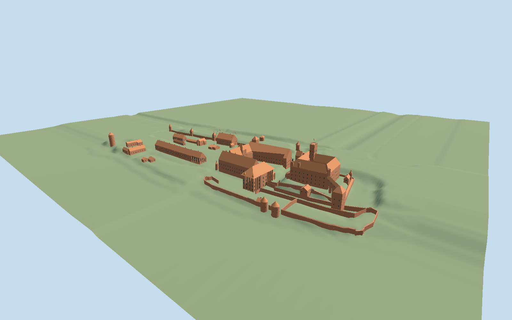

# Malbork Castle

Three-part brick Gothic Malbork: High Castle with an open cloister court, crenellated keep and church; elevated Dansker passage; U-shaped Middle Castle with an open gate, Grand Masters Palace; Lower Castle armoury, St Lawrence chapel, service ranges and named defensive towers.

## Evidence and reconstruction

Published dimensions and reconstructed details are separated in spec.json. Primary references:

- [Reference](https://www.openstreetmap.org/relation/6436433)
- [Reference](https://zamek.malbork.pl/en/home/visit/history-of-the-castle/)
- [Reference](https://bilety.zamek.malbork.pl/trasy-zwiedzania.html)
- [Reference](https://commons.wikimedia.org/wiki/File:Malbork_zamek_zblizenie.jpg)
- [Reference](https://commons.wikimedia.org/wiki/File:Malbork_-_Zamek_Średni_-_Dziedziniec.JPG)
- [Reference](https://commons.wikimedia.org/wiki/File:Zamek_wysoki_wieza_glowna.jpg)
- [Reference](https://commons.wikimedia.org/wiki/File:Malbork_Castle_Exterior_1.jpg)
- [Reference](https://commons.wikimedia.org/wiki/File:Malborg_plan_przyziemia_zamku.jpg)

No third-party geometry, photograph or bitmap texture is embedded. Shared surface graphs come from the central library; vertex tints carry model colors. Glazing uses PBR materials; transparent surfaces are declared per model.

## Model and axes

57,078 triangles; 128,140 vertices; 7 material groups; 5,302,204 bytes. Native bounds: -138.089, -13.438, -86.622 to 446.728, 58.500, 187.106. Source hash: `sha256:18af4066b3ef5de40890dfc92f1af0843e661f48a564d37bb4be46c4d836a62a`.

{"up":"+Y","longitudinal":"+X from High Castle toward Lower Castle","front":"+Z toward eastern fortifications","origin":"Exact-Q71279 component frame;Y0 reconstructed High-court working floor19m."}

Fresh exact-Q71279 relation6436433 and103 individual cached features agree within0.7mm. Native+X40.89deg follows High-to-Lower Castle toward the north-east;+Z130.89deg faces eastern defenses. Precinct replacement is disabled. Retained GUGiK public2m bare-earth Float32 crop resampled into6660-value6m native grid establishes relative contact. ModelY0 is a reconstructed19m High-court working floor in advertisedPL-EVRF2007-NH; actual viewer placement subtracts the matching bare-earth grid height at[-28,33],not a nominal floor. Separate working levels:Middle15.2m,entry14.3m,Dansker8.6m,Palace9.6m and Lower ranges roughly8–12m. Public0.5m surface crop informs approximate keep crown68.5m and pole77.5m absolute; owner nearly70m description has no datum. No survey precision or exact acquisition vintage is asserted. Model supplies grounded masonry and a narrow moat bridge without a second castle hill; host must supply fine terrain.

## Reproduce

Run `node packages/worldgen/scripts/generate-signature-towers.mjs --ids=malbork_castle` (or add `--check`). The generator preserves manually edited masters by checking their baseline hashes. Import through the standard authored-model workflow with optimization disabled; then capture all QA cameras, including shared-surface views.

## Pending work

- Original detailed516537-triangle/44329516-byte master remains exactly reproducible atsha256:7edaf912ea66d093c514a74df624f5802008ee0b261c05a1f1b0217653515193 from malbork-castle-model.mjs#malborkStudy.build. Reviewed independent source corrects levels,foundations,well primitive and gate-to-moat-bridge continuity.
- Fresh exact-Q71279 relation6436433 and103 individual cached features agree within0.7mm. Native+X40.89deg follows High-to-Lower Castle toward the north-east;+Z130.89deg faces eastern defenses. Precinct replacement is disabled. Retained GUGiK public2m bare-earth Float32 crop resampled into6660-value6m native grid establishes relative contact. ModelY0 is a reconstructed19m High-court working floor in advertisedPL-EVRF2007-NH; actual viewer placement subtracts the matching bare-earth grid height at[-28,33],not a nominal floor. Separate working levels:Middle15.2m,entry14.3m,Dansker8.6m,Palace9.6m and Lower ranges roughly8–12m. Public0.5m surface crop informs approximate keep crown68.5m and pole77.5m absolute; owner nearly70m description has no datum. No survey precision or exact acquisition vintage is asserted. Model supplies grounded masonry and a narrow moat bridge without a second castle hill; host must supply fine terrain.
- Six common brick,ceramic tile,granite,limestone,timber and painted-metal graphs plus opaque PBR glass. Skyline bakes common graph linear means into one draw. No copied photography or embedded bitmaps.
- Exterior medium-fi reconstruction. Floor levels,roof junctions,bay counts,tracery,gables,dormers and gate decoration are approximations. Madonna mosaic and figurative sculpture are omitted with their recess preserved. No interiors,archaeological ruins,complete outer earthworks or landscape.
- Bare-earth interpolation beneath occupied roofs does not establish floor elevations. Public composite data exact vintage/vertical accuracy is not asserted. Pole and crown working heights are estimated from the retained surface crop,not a surveyed tower height. Physical laptop/phone dense-view timings remain pending.
- Source and medium-fi preview use retained relative terrain; shared geographic stage lowers only its isolated review plane to-16.4m so it cannot hide the lower ranges. Model placement remains unchanged. Preview terrain outside the bounded evidence clamps to grid edges and is not additional geographic evidence.

This bundle follows the medium-fi standard. Medium-fi appearance and geographic fit are reviewed separately. Hash-bound visual acceptance is recorded separately after capture inspection.

## Additional geographic data

Map geometry © OpenStreetMap contributors, ODbL-1.0. Photographs linked for reference; no photographic textures or third-party meshes copied.
