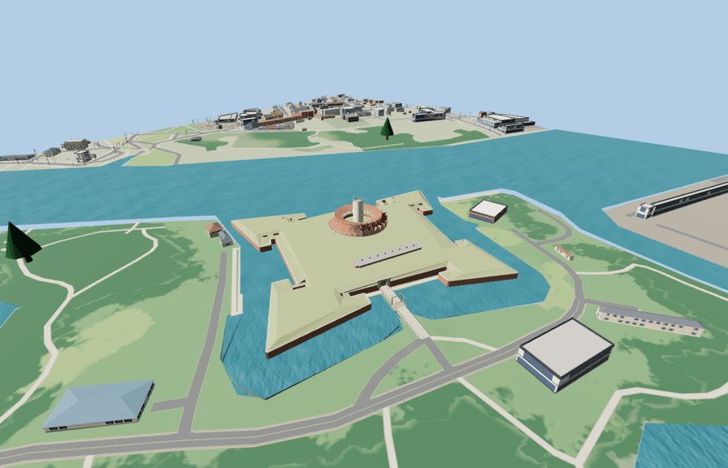

# Wisłoujście Fortress

The four bastions, flat-topped white watchtower, circular tiled gallery and row of gabled pink houses remain distinct at all four viewer distances. Closer views retain the gate, recesses, courtyard joinery and timber drawbridge. The detailed master also retains the gallery’s fine joinery, roof fittings, window bars and chains.

The mapped watchtower, ramparts and bridge share a north-up frame. The viewer places the fort at a 3.75 m datum over the retained moat. The drawbridge deck stands about 1.63 m above the fixture waterline. A small grade on the east bank matches the service road to the causeway. The viewer replaces eight mapped fort building records and one matching bridge line, keeping 214 other buildings and 337 other road records. On failed load it restores the original native bridge and buildings.

| Detail level | Triangles | Download bytes | Draws |
| --- | ---: | ---: | ---: |
| skyline | 906 | 74,220 | 7 |
| district | 2,134 | 166,804 | 8 |
| street | 13,264 | 960,664 | 8 |
| closeup | 51,218 | 3,662,668 | 8 |

The source rebuild reproduces the original 101,942 triangles byte for byte. The first two browser tiers total 241,024 bytes. All six GLBs use shared materials and contain zero embedded images.

A failed model load retains the mapped stadium. All four tiers release their geometry on unload. The review covers 43 captures and 100 placement samples.

The fort and eastern road fit use the standard viewer terrain and water surfaces. The exact masonry foundations and current tidal variation have limited evidence.

The model depicts the restored Fort Carré and its eastern drawbridge. The museum’s planned tower spire and outer Eastern Rampart remain outside this model scope.

[Museum restoration photographs](https://media.muzeumgdansk.pl/komunikaty/817511/nowe-oblicze-twierdzy-wisloujscie) · [Mapped terrain fit](site-fit.json) · [QA evidence](qa.json)
