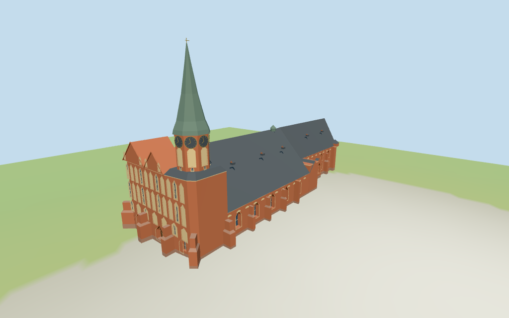

# Königsberg Cathedral

Individual medium-fi Königsberg Cathedral exterior:asymmetric detailed westwork,octagonal clock drum/green concave spire,north/central gables,steep dark long roof,broader nave/narrower choir,paired pointed windows,mapped buttresses,two minor turrets and open northeast Kant tomb colonnade. Exact inscriptions/sculpture/tracery,full interiors and certified walking excluded.

## Evidence and reconstruction

Published dimensions and reconstructed details are separated in spec.json. Primary references:

- [Reference](https://commons.wikimedia.org/wiki/File:Kaliningrad_05-2017_img04_Kant_Island.jpg)
- [Reference](https://commons.wikimedia.org/wiki/File:Kaliningrad_05-2017_img09_Kant_Island.jpg)
- [Reference](https://visit-kaliningrad.ru/entertainment/sights/sightseeings/mogila-kanta/)
- [Reference](https://commons.wikimedia.org/wiki/File:Kaliningrad_05-2017_img05_Kant_Island.jpg)

Five existing 256-square brick,raw limestone,standing-seam metal,copper and plain wood graphs. Warm brick walls,cream blind panels,pink stone colonnade,dark gray metal roof and subdued green spire. Clock gold shares copper;glazing is flat blue-gray. Metric UVs,hard architectural normals,no embedded images.

## Model and axes

6,291 triangles; 18,873 vertices; 8 material groups; 759,632 bytes. Native bounds: -20.819, -1.321, -26.541 to 83.140, 51.450, 8.893. Source hash: `sha256:edce2ecf110bd80dc69889b7fb93d76ad17e641f7b0ab2f7fd1d2de3e6af40e4`.

{"x":"east toward narrower choir","y":"up","z":"south toward tall clock spire"}

Standard DEM datum 2.246535m;estimated common floor 0.7m clears sampled compound peak 0.257m and perimeter -0.97..0.22m. Foundations follow coarse terrain. Exact thresholds,absolute altitude and certified walking unverified;no independent survey.

## Reproduce

Run `node packages/worldgen/scripts/generate-additional-landmarks.mjs --ids=N0353` (or add `--check`). The generator preserves manually edited masters by checking their baseline hashes. Import through the standard authored-model workflow with optimization disabled; then capture all QA cameras, including shared-surface views.

## Pending work

- Current unscaled PMTiles main outline,26 building-part controls and northeast tomb plan define horizontal fit. Tower20m,spire50.75m,nave8m,choir11m,roof turret26m and east turret14m are mapped tags,not independent surveyed dimensions. Nave/choir tags are used as eaves with estimated24m continuous ridge;west gables26/25m,octagonal drum30m and spire subdivisions are picture-led estimates. Tomb5m tag conflicts with tall pictured columns;10.4m entablature is an explicit picture-led override. Preserve uncertainty;no exact-QID footprint claim.
- Standard DEM datum 2.246535m;estimated common floor 0.7m clears sampled compound peak 0.257m and perimeter -0.97..0.22m. Foundations follow coarse terrain. Exact thresholds,absolute altitude and certified walking unverified;no independent survey.
- Exterior approximation from four useful pictures and standard PMTiles/DEM. Nave/choir height tags are interpreted as eaves;estimated ridge and gable/clock-drum subdivisions,paired lancets,west blind-panel cadence,tomb height/columns/screen and roof vents are picture-led. No exact historical tracery,lettering,clock numerals,sculpture,full interiors or certified walking. Absolute altitude/thresholds and physical device timings pending.
- Skyline preserves principal masses and open tomb bays with simplified buttresses/columns. District adds shared surfaces,flat pointed windows/closed door,blind panels/clocks and cornice rhythm. Street opens real facade recesses with mullions;closeup/master refine frames,clock marks and roof vents. Curvature,windows,ornament and tomb-column cadence change visibly. Synthetic cottage neighbors are diagnostic context,not local map buildings.

This bundle follows the medium-fi standard. Medium-fi appearance and geographic fit are reviewed separately. Hash-bound visual acceptance is recorded separately after capture inspection.

## Additional geographic data

©OpenStreetMap contributors;Protomaps;Mapzen/USGS terrain tiles.
