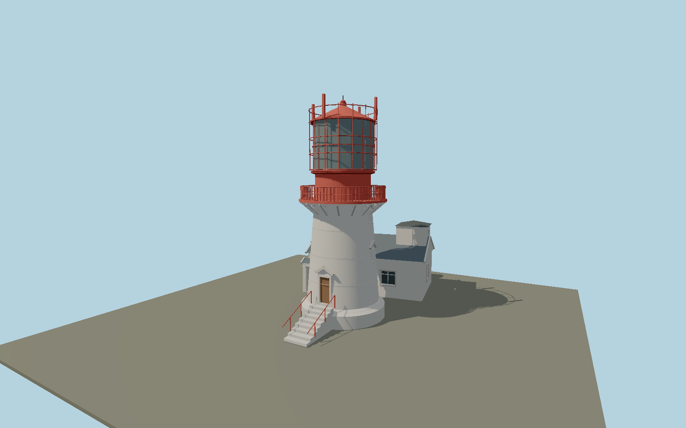

# Lindesnes Lighthouse — N0660

White short cast-iron tower on a concrete foot, north entrance stair, pedimented small windows and pierced white gallery brackets. Tall red watchroom/lantern assembly, fine cleaning cage and red antenna panels, plus connected white clapboard machinery house with slate roof, rooftop horn and twin pressure tanks.

## Identity and evidence

Exact catalog identity **Q773320**. Source facts: `{"heightMeters":16.1,"mainHousePlanMeters":[10.4,6],"year":1915,"originalMasterHash":"sha256:70d8b60beafca96b1e923d2a7db8c3454ac967f11942912eb583f32b7261daba","basis":"Kystverket2020 conservation planpp19–22 and27–29:1913cast-plate details, current cardinally labeled exterior,10.4x6m machinery-house plan, north vestibule, south tanks and west roof horn. Exact-QID node and mapped main entrance independently sign tower yaw; attached-house polygon corroborates its south position and separate wall yaw."}`. The source specification keeps published dimensions separate from reconstructed details.

- https://www.kystverket.no/globalassets/om-kystverket/kystkultur/fyr/sorost/lindesnes-fyrstasjon_forvaltningsplan_14.-oktober-2020_red_sec_kort.pdf
- https://www.visitnorway.no/listings/lindesnes-fyr/16446/
- https://lindesnesfyr.no/en/staying-overnight/
- https://www.openstreetmap.org/node/31289203
- https://www.openstreetmap.org/node/7453360612
- https://www.openstreetmap.org/way/172893415

Original geometry and shared procedural materials. Official photographs are research references only; no reference imagery or third-party mesh is embedded or redistributed.

## Authored geometry and materials

57,234 triangles, 103,456 vertices, 7 surface groups; 4,415,424 source bytes. SHA-256: `sha256:8d6880739b5d22d5ad1a612e7f80e67e10105ec9ceb89d2c84781cbe6484b5d1`. Actual bounds: -7.086, 0.000, -13.735 to 4.646, 16.100, 6.041 m.

Shared canonical material graphs with metric UV repeats in extras.molenSurface; portable glTF PBR factors and vertex colors remain. Dark recesses/lantern panels retain local fallback materials. Shared references: `matgraph:molen.worldgen.material.wood_painted_lap` (2 × 1.6 m), `matgraph:molen.worldgen.material.slate` (1.5 × 1.6 m), `matgraph:molen.worldgen.material.metal_painted` (2 × 2 m), `matgraph:molen.worldgen.material.stone_granite` (2 × 2 m), `matgraph:molen.worldgen.material.wood_plain` (2 × 0.25 m), `matgraph:molen.worldgen.material.concrete_plain` (2 × 2 m). Model-native axes: {"up":"+Y","front":"+Z","origin":"Tower concrete foot center,Y0host terrain contact; +Z doorway/steps toward mapped north-slightly-west entrance. House extends-Z south, with independently rotated E-W long walls and north-side vestibule."}.

## Placement proposal

+Y up; +Z doorway and stair toward mapped main entrance, bearing355.598degrees true. White machine house extends south(-Z); long walls have independent local yaw0.157rad, west roof horn at+X and paired tanks at-Z. Cardinally labeled operator2020 photos and plan independently choose the entrance, house, horn and tank quadrants. Map coordinates and entrance point establish identity and signed frame, not a survey. Circular tower diameter approximately6.3m agrees with original1913drawing and current OSM outline. Published10.4x6m house is retained despite approximately10.8x7m mapped outer rectangle including cladding/porch. House center/yaw match mapping to about0.2m/0.012degrees. North-side vestibule dimensions and all small fittings are photo/plan proportions. Structureheight16.1m is separate from lightfocalheight66.1m; base uses host terrain rather than a surveyed mean-sea-level offset. Natural headland and detached buildings excluded; footprint replacement stays off. Proposed anchor 7.0466733, 57.9824978 (longitude, latitude), heading -3.0647546436407804 radians. Elevation policy: **terrain-contact**. This is a reviewable proposal, not a completed site-fit certification. Ground models require terrain contact; offshore models also require water-datum and base-height checks.

## Limitations and review

- The modeled exterior follows the cited published facts and inspected photographs. Unpublished dimensions and local fittings are explicitly photo-proportioned; no claim of engineering survey accuracy is made.
- Portable PBR and shared metric surfaces are provided. Surface weathering, material color under local lighting and fine facade relief require close render review before maximum-detail acceptance.
- Exterior components use conservation drawings and2020 operator/museum appearance; exact bolt instances and internal lens mechanism are omitted at this shared-style exterior scope. Site houses farther down the rock and old beacon ruin are separate structures.

Near/far fixtures are in `spec.qaCameras`. Float32 finite geometry, triangle degeneracy and winding are checked by the generator. Current rendering, shared-material, maximum-fidelity and geographic review results are recorded in `qa.json` and the readiness ledger; source generation alone does not approve a model.

Regenerate with `node packages/worldgen/scripts/generate-lighthouse-models.mjs --ids=N0660`; add `--check` for reproducibility. Editable component recipes are in `packages/worldgen/scripts/lighthouse-northsea-models.mjs`. The generator protects artist-edited master hashes and preserves import/capture/shared-capture/QA documents.
