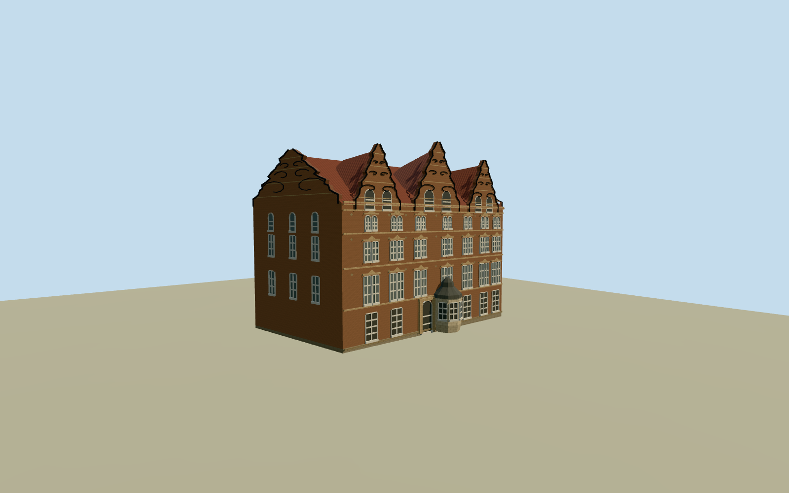

# Jens Bang's House

The four-storey Jens Bangs Stenhus in Aalborg with ornate brick gables, pale sandstone and a projecting window bay.

Authoring state: **review-in-qa.json**. Current completion evidence is in [qa.json](qa.json) and the [completion ledger](../../../../qualla-structures/batches/qualla-004.PROGRESS.md).

- [Jens Bang's House](https://qualla.com/jens-bang-s-house/)

Extent covers the named merchant house and its attached exterior bay. Neighboring buildings are separate.

The relief carvings, rear openings and roof dimensions are visually estimated.

Build: `node content/worldgen/source/places/u4/u4p/jens_bang_s_house/models/generate-jens-bang-s-house.mjs`. Add `--check` to verify exact regeneration. 10761 triangles; 7 materials; no embedded photographs.
