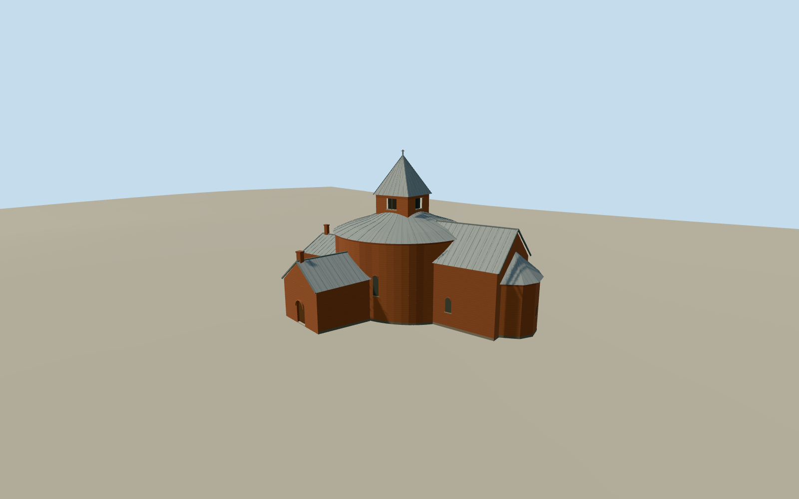

# Thorsager Church

A round brick Romanesque nave with a swept silver-gray roof and square belfry. The eastern chancel and curved apse, south porch and low west tower block follow the mapped church outline.

Authoring state: **review-in-qa.json**. Current completion evidence is in [qa.json](qa.json) and the [completion ledger](../../../../qualla-structures/batches/qualla-003.PROGRESS.md).

- [Thorsager Church](https://qualla.com/thorsager-church/)

The model represents the exterior as seen in April 2009. The mapped perimeter fixes component layout. Roof heights, pitch, masonry detail and partly obscured elevations are estimated from two cleared views.

Original public elevation samples are preserved. Churchyard paving and individual doorway thresholds are approximate.

Build: `node content/worldgen/source/places/u4/u4p/thorsager_church/models/generate-thorsager-church.mjs`. Add `--check` to verify exact regeneration. 4413 triangles; 5 materials; no embedded photographs.
