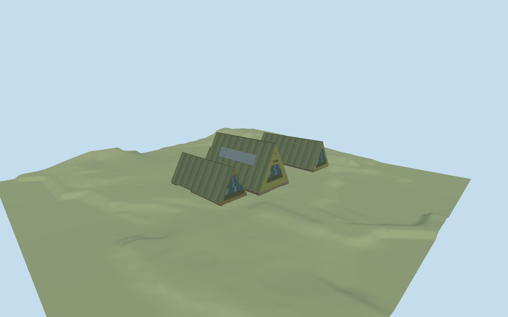

# Fram Museum

Fram Museum at Bygdøynes with three copper A-frame halls, the glazed waterfront gable and the lower triangular entrance.

Authoring state: **review-in-qa.json**. Current completion evidence is in [qa.json](qa.json) and the [completion ledger](../../../../qualla-structures/batches/qualla-003.PROGRESS.md).

- [Fram Museum](https://qualla.com/fram-museum/)

The relief and the roof heights come from the mapping agency’s terrain and surface surveys. Seam spacing, doors, glazing and roof-light subdivisions are estimated. The museum’s smaller south gable is visible in the 2012 exterior. Gjøa opened in 2013, and its end glazing and entrance detail are interpreted from its mapped plan, surface survey and the museum’s architectural description.

The three exterior halls are represented. The exhibition ships, the underground connection, neighbouring museums and the waterfront visitor facilities are outside scope.

Build: `node content/worldgen/source/places/u4/u4x/fram_museum/models/generate-fram-museum.mjs`. Add `--check` to verify exact regeneration. 3137 triangles; 5 materials; no embedded photographs.
