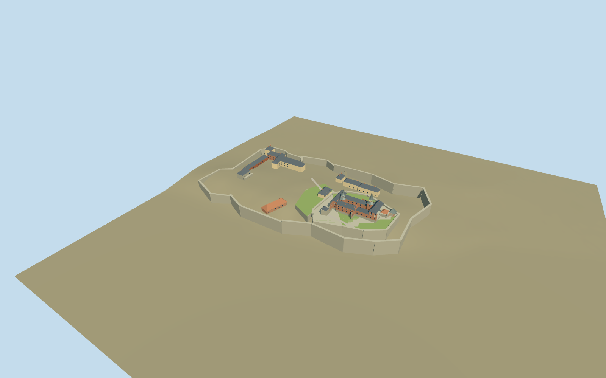

# Akershus Fortress

Akershus inner-fortress study:open mapped castle court,two faceted clock spires,stepped-gable wings,stone lower towers,terraced bastion silhouette and selected low museums,magazines and barracks. Wider site/elevations explicitly approximate.

## Evidence and reconstruction

Published dimensions and reconstructed details are separated in spec.json. Primary references:

- [Reference](https://www.forsvarsbygg.no/en/festningene/akershus-fortress)
- [Reference](https://www.forsvarshistoriskmuseum.no/akershus-slott/en)
- [Reference](https://www.forsvarshistoriskmuseum.no/historien-om-akershus-festning)
- [Reference](https://historiaviagenselivros.com/wp-content/uploads/2017/10/akershus-fortress-mapa.pdf)
- [Reference](https://www.openstreetmap.org/relation/13931023)

No third-party geometry, photograph or bitmap texture is embedded. Shared surface graphs come from the central library; vertex tints carry model colors. Glazing uses PBR materials; transparent surfaces are declared per model.

## Model and axes

3,765 triangles; 11,295 vertices; 8 material groups; 456,320 bytes. Native bounds: -92.700, -22.754, -304.695 to 133.649, 46.000, 99.627. Source hash: `sha256:e98101005da11a113bf5b3a6382024eae71d55a5f019b8adcf2a7c6939308d7d`.

{"up":"+Y","longitudinal":"+Z south toward Munk Tower and Prince Carl bastion","lateral":"+X east toward Kongens gate","origin":"Site anchor; Y0 standard PMTiles working datum."}

The inspected aerial picture confirms two clock spires, open castle court, stepped gables and mixed stone/brick wings. Standard viewer PMTiles and the retained castle footprint establish approximate coastal location and east/south orientation. A reconstructed8m datum reduction places the original12m court at4m above the PMTiles anchor sample; bounded stone terrace/foundation bottoms extend to coarse ground. Broad invented lower lawn terrain and study pond surfaces are omitted so host terrain supplies the lower precinct. Wider building/bastion layout remains approximate. Anchor 10.736251164,59.906686713; heading 0; standard PMTiles datum 21.632957278541383m. Floors are reconstructed and foundations extend below the coarse sampled ground.

## Reproduce

Run `node packages/worldgen/scripts/generate-signature-towers.mjs --ids=N0282` (or add `--check`). The generator preserves manually edited masters by checking their baseline hashes. Import through the standard authored-model workflow with optimization disabled; then capture all QA cameras, including shared-surface views.

## Pending work

- Approximate current inner-fortress exterior from inspected picture and standard viewer PMTiles; no bespoke survey or exact thresholds.
- Original detailed architectural/terrace study master and recipe preserved; derivative fits working datum and bounded stone foundations while omitting broad lower terrain/pond surfaces.
- Two clock spires, stepped gables, open castle court, lower towers, stone bastions and selected low museums/magazines/barracks retain identity. Fine openings, names-to-tower assignment and elevations reconstructed.
- Only the castle/court are map-derived; broader inner-fortress layout is approximate and footprint replacement remains off.
- Host supplies lower terrain. Study pond depressions, modern military administrative parcels, full harbor/quay, trees, artillery, memorials, demolished defenses and interiors excluded.
- Six common material graphs and local glass/upper terrace color slots; eight merged groups justified by the mixed precinct. Zero embedded images. Physical-device timing pending.

This bundle follows the medium-fi standard. Medium-fi appearance and geographic fit are reviewed separately. Hash-bound visual acceptance is recorded separately after capture inspection.

## Additional geographic data

© OpenStreetMap contributors;Forsvarsbygg/National Fortifications Heritage and Forsvarshistorisk museum.
