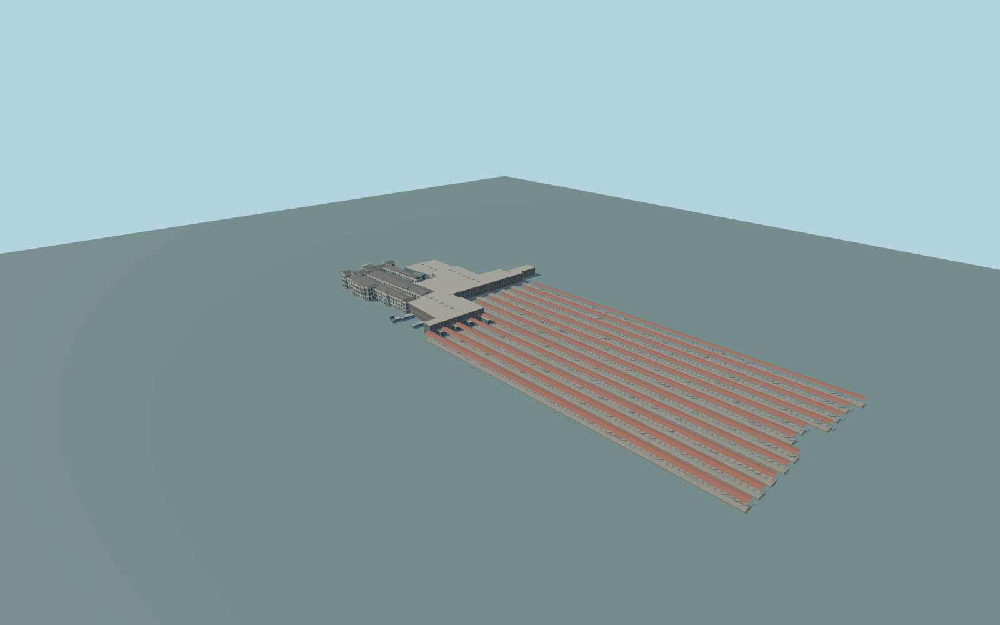

# Oslo Central Station

Complete Oslo Central regional station exterior:modern main concourse/entry andsouthern connectinghall,wholehistoricalOstbanehallen/GrandCentral perimeterwings withtheir internalcourts retained,glass/metal westentry,all eleven longitudinal platformcanopies withtheir mappedend shelters,andactual stair/liftclosures. IndependentByporten/Scandicnorthcomplex,Posthuset tower/postalterminal,Radisson,ScandicOpera southeast hotel,Akrobaten footbridge,Schweigaards elevatedroadbridge,Ruter forecourtclocktower,streetplazas andother independentbuildings remain separate. No trains,people,logos,lettering ornavigable railinteriors. Theattached native10m northernstationwing,whole13m southernendhall andcentralmappedinnerhallclosure areincluded;the unheightedinnerclosure usesanexplicit13m glazed-roofestimate.

Rebuild: `node packages/worldgen/scripts/generate-oslo-station.mjs`;append `--check` for exact source bytes. Select import/LOD/placement with `--ids=oslo_central_station`. Detailed source and four browser tiers are separate ignored GLB outputs.

Complete Oslo Central regional station exterior:modern main concourse/entry andsouthern connectinghall,wholehistoricalOstbanehallen/GrandCentral perimeterwings withtheir internalcourts retained,glass/metal westentry,all eleven longitudinal platformcanopies withtheir mappedend shelters,andactual stair/liftclosures. IndependentByporten/Scandicnorthcomplex,Posthuset tower/postalterminal,Radisson,ScandicOpera southeast hotel,Akrobaten footbridge,Schweigaards elevatedroadbridge,Ruter forecourtclocktower,streetplazas andother independentbuildings remain separate. No trains,people,logos,lettering ornavigable railinteriors.

Mapped mainhall12m,westhall8m,southhall13m andhistoricwing16/18/19/20m heights are retained. Roofpitch/ridge profiles,individual historicopenings andwestglazedentrysection are ordinary-picture interpretations. Theeleven wholelongitudinalroofplans connectmapped terminalcovers throughphoto-observed canopyrows;middleextent/width/trackinventory is approximate ratherthan pretendingstair-coverpolygonsarethewholecanopies. Canopyfloor1.4m/eave7.2m/ridge8m are fixed sourcelevels ononecommon datum;nativeheight8m doesnotestablish surveyed railgrade. Near/farcanopysection spacing andsupports remainmedium-fi interpretations. One unchanged standard global field sample outside the historic western facade at[-120,65],2.625264m,defines commonY=0. Main/historic floor+.65m;platform floors+1.4m;canopyeaves7.2m andridges8m;footings-8m. No perpart runtimehostoffsets orflattening.

Three ordinary exterior pictures andstandardPMTiles. Fullregional station exterior,modernhalls,historicwings andeleven wholecanopyrows are retained. Independentcommercialcomplexes,towers,hotels,publicbridges andRuterclocktower areexcluded. Exactcurrentroofinventory,hiddenfacades,courts/thresholdlevels andrailclearance remainapproximate. No surveyed/navigable interiorclaim. Physical laptop/phone/dense-city timing andnumericalLODerrors remainunmeasured.

Eight existing shared256px graphs:plaster_lime,brick,stone_granite,slate,metal_standing_seam,metal_painted,window_grid andmembrane. Atmost8mergednear groups,metricUVs,linearcolors;zero embedded/privateimages. Only actualwindow/entry/stair glazing useswindow_grid;plaster,brick,roofs,frames andfoundationsretainsemanticbindings. Fourwhole-structuretiers retainallhistoricwings,modernhalls,westentry andelevenentirecanopyrows;nearlevelsaddrealarchrecesses/cornices,pilasters,roofvents,entryframes,dormers,smallclock,canopyposts/braces andstairs. Detailedmaster separatelyrefinesarchedrecesses,joinedframes,vents,fullsupportinventory andrailhardware.

Original geometry:repository license. Map:© OpenStreetMap contributors,ODbL-1.0;Protomaps. Standard terrain:terrain-grid.json. Ordinary pictures stay local and are not redistributed or used as textures. Current acceptance:qa.json.
