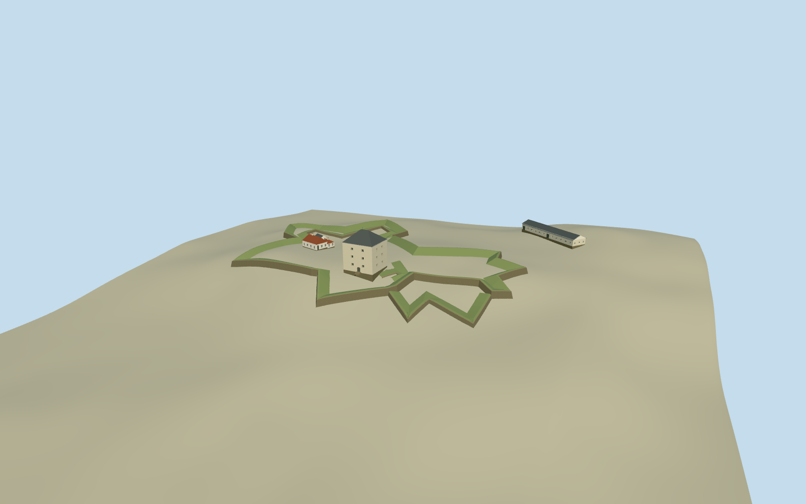

# Kristiansten Fortress

Trondheim’s limewashed Kristiansten Donjon above angular stone ramparts, with slate roofs, grassed crests, the red-roofed Commandant’s Residence and the long white magazine.

Authoring state: **review-in-qa.json**. Current completion evidence is in [qa.json](qa.json) and the [completion ledger](../../../../qualla-structures/batches/qualla-004.PROGRESS.md).

- [Kristiansten Fortress](https://qualla.com/kristiansten-fortress/)

Bastion crest and backfill levels and the Donjon’s section are interpreted from the map, terrain and exterior photographs. The model covers the principal group and preserves the outline of the angular fort. Interiors and detached equipment are outside the model.

Build: `node content/worldgen/source/places/u5/u5r/kristiansten_fortress/models/generate-kristiansten-fortress.mjs`. Add `--check` to verify exact regeneration. 6703 triangles; 6 materials; no embedded photographs.
