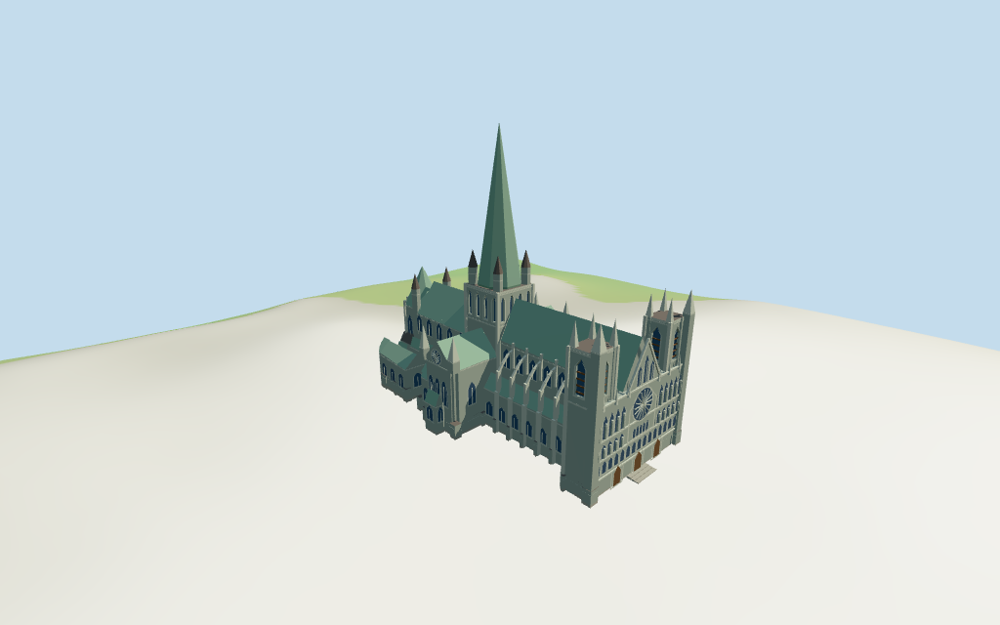

# Nidaros Cathedral

Individual Nidaros exterior: broad twin-tower west sculpture screen/rose/three closed portals, high green crossing spire/four conical turrets, green pitched nave/choir, lower aisles and flying buttresses, transepts and eastern octagon/ambulatory.

## Evidence and reconstruction

Published dimensions and reconstructed details are separated in spec.json. Primary references:

- [Reference](https://en.wikipedia.org/wiki/File:Die_Nidaros_Kathedrale_in_Trondheim._02.jpg)
- [Reference](https://en.wikipedia.org/wiki/File:Nidaros_Cathedral,_Trondheim,_West_view_20150605_1.jpg)

Five existing shared256-square limestone/raw-stone/standing-seam/slate/wood graphs, metric UVs and linear tints; flat blue-gray glass. No embedded images or photograph textures.

## Model and axes

15,571 triangles; 46,713 vertices; 7 material groups; 1,872,768 bytes. Native bounds: -53.200, -1.090, -25.676 to 50.741, 82.500, 25.331. Source hash: `sha256:abe3a94e6bcd7e75fb30c7dea881152d7705dd55f7a45039b3a59ff68d9680da`.

{"x":"east along nave from western screen","y":"up","z":"south across nave"}

Individual exterior from two useful pictures and standard viewer PMTiles/DEM. NativeY0 follows13.866477m standardDEM; estimated floor0.5m clears coarse perimeter-0.74..0.23m. Foundation/plaza/step joins remain approximate; no surveyed thresholds or certified walking surfaces.

## Reproduce

Run `node packages/worldgen/scripts/generate-additional-landmarks.mjs --ids=nidaros_cathedral` (or add `--check`). The generator preserves manually edited masters by checking their baseline hashes. Import through the standard authored-model workflow with optimization disabled; then capture all QA cameras, including shared-surface views.

## Pending work

- Current PMTiles nominal nave35m, choir32m, transepts26m, aisle/chapel11..15m, west towers36m, crossing38m, east octagon36m and central spire82m retained. Mapped west pinnacles42/43m, transept corner cones29m and crossing turrets48m control their crown heights. Eaves, intermediate profiles, gallery rhythm, sculpture reliefs and portal dimensions are picture-led estimates; nominal heights and exact thresholds are unverified.
- Individual exterior from two useful pictures and standard viewer PMTiles/DEM. NativeY0 follows13.866477m standardDEM; estimated floor0.5m clears coarse perimeter-0.74..0.23m. Foundation/plaza/step joins remain approximate; no surveyed thresholds or certified walking surfaces.
- Statue reliefs and niche/tracery rows are selected faceted approximations, not identified individual figures or exact sculpture. Spire finial/weathercock, full interiors, graves/trees and surrounding Archbishop’s Palace excluded. Closed doors and selected belfry reveals do not certify walking surfaces. Physical laptop/phone timing pending.
- Skyline retains central spire, twin western masses/outer pinnacles and eastern octagon with closed stages and mean surface tint. District restores shared textures, broad windows and turrets; street restores actual belfry cuts, flying arches, west niche/rose rhythm and trim; closeup refines arch/rose facets, selected reliefs, louvers and mullions. Detail changes remain visible.

This bundle follows the medium-fi standard. Medium-fi appearance and geographic fit are reviewed separately. Hash-bound visual acceptance is recorded separately after capture inspection.

## Additional geographic data

©OpenStreetMap contributors; Protomaps; Mapzen/USGS terrain tiles.
