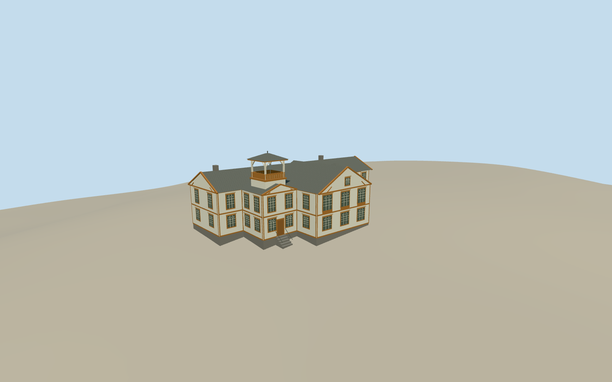

# Ringve Manor House

Ringve’s main manor house in September 2009, with the garden gable, painted timber siding, ochre surrounds and two unequal towers, including the open lookout.

Authoring state: **review-in-qa.json**. Current completion evidence is in [qa.json](qa.json) and the [completion ledger](../../../../qualla-structures/batches/qualla-003.PROGRESS.md).

- [Ringve Museum](https://qualla.com/ringve-museum/)

The modern mapped perimeter represents the historic envelope evident in the cleared 2006 and 2009 photos. Roof heights, timber braces, window details, threshold and foundation exposure are approximate.

The original provider terrain is unchanged. Modern relief slopes east to west around the building. The model represents the main manor before the 2015 fire. The detached museum ranges, formal gardens and interiors are outside scope.

Build: `node content/worldgen/source/places/u5/u5r/ringve_museum/models/generate-ringve-manor.mjs`. Add `--check` to verify exact regeneration. 6458 triangles; 5 materials; no embedded photographs.
