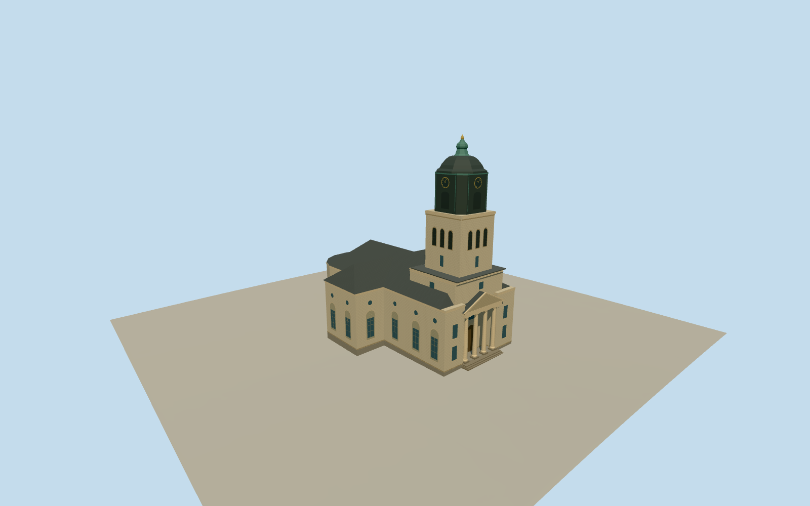

# Gothenburg Cathedral

The classical pale stone cathedral, recessed west entrance and portico, dark 52.85-meter clock tower, transepts and rounded east apse.

Authoring state: **review-in-qa.json**. Current completion evidence is in [qa.json](qa.json) and the [completion ledger](../../../../qualla-structures/batches/qualla-003.PROGRESS.md).

- [Gothenburg Cathedral](https://qualla.com/gothenburg-cathedral/)

December 2025 exterior. The surviving east form is guided by two cleared 2008 photographs. Interiors and surrounding grounds are outside the asset.

Secondary roof junctions, fine clock ornament, window tracery and individual stone courses are approximate.

The original terrain is retained. Foundation and individual threshold heights are approximate.

Build: `node content/worldgen/source/places/u6/u62/gothenburg_cathedral/models/generate-cathedral.mjs`. Add `--check` to verify exact regeneration. 3925 triangles; 5 materials; no embedded photographs.
