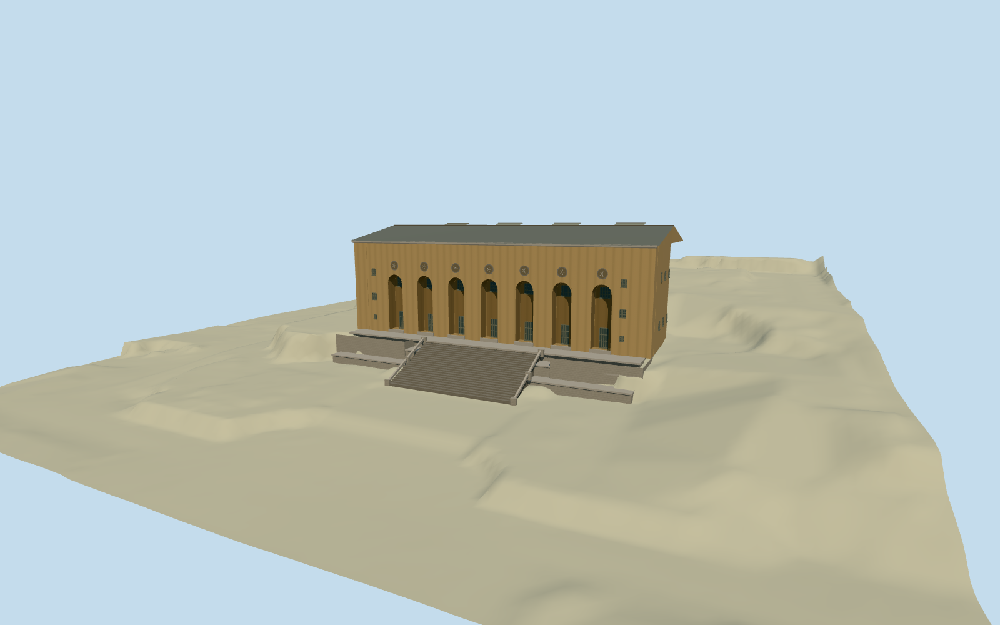

# Gothenburg Museum of Art

Gothenburg’s original yellow-brick art museum, with seven monumental arches above its cut-stone terraces.

Authoring state: **review-in-qa.json**. Current completion evidence is in [qa.json](qa.json) and the [completion ledger](../../../../qualla-structures/batches/qualla-004.PROGRESS.md).

- [Gothenburg Museum of Art](https://qualla.com/gothenburg-museum-of-art/)

The model focuses on the 1923 gallery and seven-arched entrance. The 1968 and 1996 additions, the Poseidon statue and independent neighbouring buildings are outside the model.

Historical rear transitions, exact wall slopes and small medallions are representative.

Build: `node content/worldgen/source/places/u6/u62/gothenburg_museum_of_art/models/generate-gothenburg-museum-of-art.mjs`. Add `--check` to verify exact regeneration. 6760 triangles; 6 materials; no embedded photographs.
