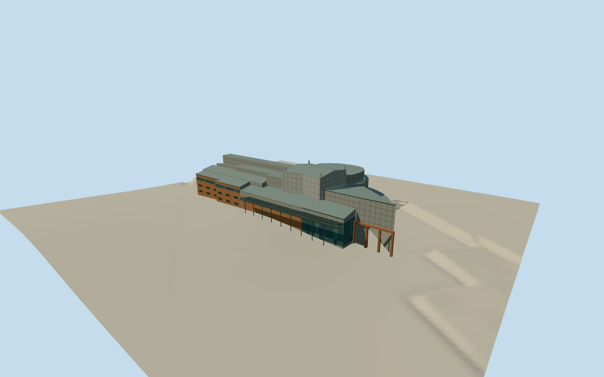

# Gothenburg Opera House

The Gothenburg Opera House at Lilla Bommen, with an ochre public wing, concrete fly towers, glazed foyer, detached entrance frames and curved waterfront galleries.

Authoring state: **review-in-qa.json**. Current completion evidence is in [qa.json](qa.json) and the [completion ledger](../../../../qualla-structures/batches/qualla-003.PROGRESS.md).

- [Gothenburg Opera House](https://qualla.com/gothenburg-opera-house/)

The building represents the public frontage documented in 2008. The map records the surviving outline and roof groups. Unseen waterfront panels, minor alterations, bracing and door details are approximate.

Original public elevation samples are preserved. Precise paving, quay levels and tidal water levels are approximate.

Build: `node content/worldgen/source/places/u6/u62/gothenburg_opera_house/models/generate-gothenburg-opera-house.mjs`. Add `--check` to verify exact regeneration. 3493 triangles; 5 materials; no embedded photographs.
