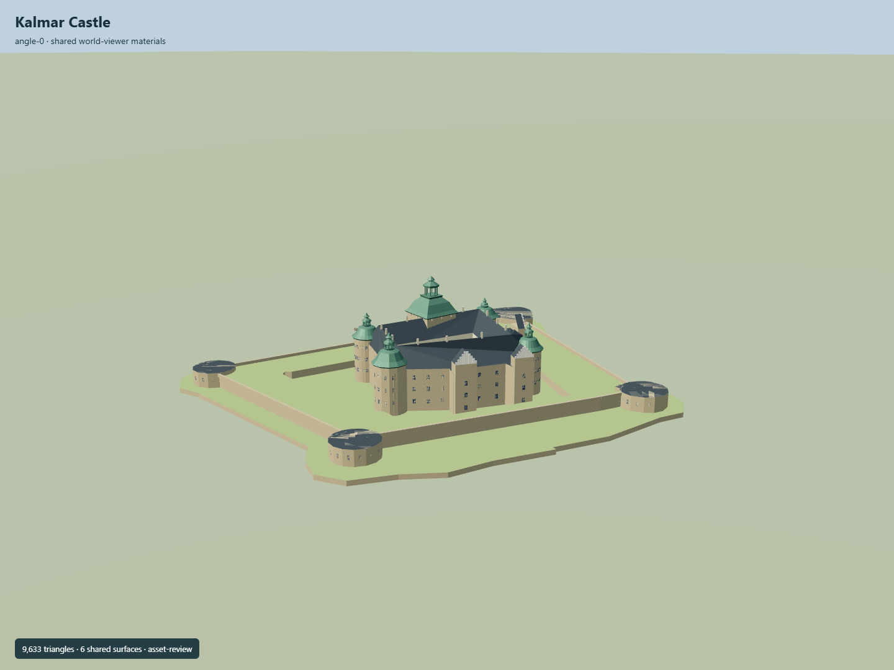

# Kalmar Castle

Open irregular Renaissance courtyard and four gabled wings,three round and one dodecagonal tower with distinct copper helmets,square Kuretornet with open lantern/old entrance,white Renaissance gables,original well canopy,mapped outer defenses and four cannon towers with western timber bridge.

## Evidence and reconstruction

Published dimensions and reconstructed details are separated in spec.json. Primary references:

- [Reference](https://api.openstreetmap.org/api/0.6/map?bbox=16.352,56.6564,16.3583,56.6596)
- [Reference](https://kalmarslott.se/)
- [Reference](https://www.sfv.se/vara-fastigheter/sverige/kalmar-lan/kalmar-slott)
- [Reference](https://kalmarslott.se/historia/historien-om-kalmar-slott/)
- [Reference](https://kalmarslott.se/historia/utveckling/)
- [Reference](https://cms.sfv.se/media/cjbpyeoq/kalmarslott_flygfoto1-komprimerad.jpg)
- [Reference](https://cms.sfv.se/media/mq2ddbi1/20170827_152248.jpg?width=800&height=1200&mode=crop&format=webp&autoorient=true&rxy=0.5213032581453634)

Six existing256-square shared graphs with linear tints and central metric UV repeats; plain glass/grass. No new/embedded image,photo texture or downloaded mesh. Courtyard is a physical hole at every level.

## Model and axes

9,633 triangles; 28,899 vertices; 8 material groups; 1,160,524 bytes. Native bounds: -111.141, -4.825, -120.786 to 103.816, 50.000, 107.463. Source hash: `sha256:a7d9df6d5d7142e1dd2fe4ddd91e5abece7591f899f71585833b50aa01ee5960`.

{"up":"+Y","front":"Mapped western bridge and old Kuretornet entrance, baked into East/South coordinates","longitudinal":"+Z south","origin":"Site anchor; Y0 standard PMTiles working datum."}

The inspected aerial picture supports the open court, copper helmets, steep dark roofs, stepped gables and bounded island defenses. Retained east/south map coordinates with heading0 set approximate footprint and western approach. Standard viewer PMTiles supply surrounding terrain; reconstructed court floorY4.7 is above coarse ground and the island/pier toes reach the same sampler at every level. Broad water simulation and terrain cutouts are excluded. Anchor 16.355425549,56.657997261; heading 0; standard PMTiles datum 6.099512477948403m. Floors are reconstructed and foundations extend below the coarse sampled ground. The western bridge deck and railings slope toward the sampled outer approach; its inner end retains the reconstructed court level.

## Reproduce

Run `node packages/worldgen/scripts/generate-signature-towers.mjs --ids=N0296` (or add `--check`). The generator preserves manually edited masters by checking their baseline hashes. Import through the standard authored-model workflow with optimization disabled; then capture all QA cameras, including shared-surface views.

## Pending work

- Approximate current exterior and fit from inspected picture and standard viewer PMTiles; no bespoke survey or exact thresholds.
- Detailed original master/hash/recipe preserved. Tower profiles, aperture/restoration detail and low island levels are interpreted; interiors and collision excluded.
- Six common graphs plus explicit glass/foliage color slots, zero embedded images. Bounded island/defenses retained; surrounding coast and water come from host data.
- Footprint replacement remains off; physical-device timing unmeasured.

This bundle follows the medium-fi standard. Medium-fi appearance and geographic fit are reviewed separately. Hash-bound visual acceptance is recorded separately after capture inspection.

## Additional geographic data

© OpenStreetMap contributors; Statens fastighetsverk; Kalmar Slott.
