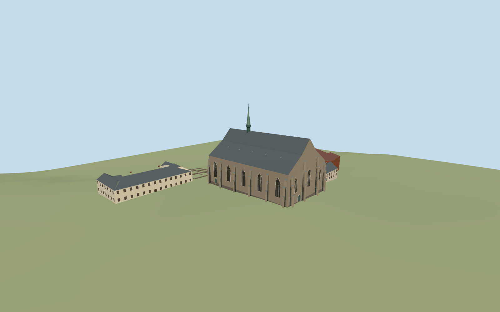

# Vadstena Abbey

Vadstena Abbey’s two-pitch slate hall church, copper flèche, surviving palace and cloister ranges, and low ruin foundations.

Authoring state: **review-in-qa.json**. Current completion evidence is in [qa.json](qa.json) and the [completion ledger](../../../../qualla-structures/batches/qualla-003.PROGRESS.md).

- [Vadstena Abbey](https://qualla.com/vadstena-abbey/)

The standing envelopes, separate ranges and surviving walls follow their mapped positions. Eaves, flèche and individual buttress depths are approximate.

The abbey church’s two eastern portals, pointed tracery and tiered slate roofs follow the surviving church. Secondary masonry openings and the 1926 sacristy dimensions are generalized.

The former palace and nuns’ wings are based on mapped ranges and owner material descriptions. Their exact window spacing, minor roof details and individual ruins’ surviving heights are approximations.

Build: `node content/worldgen/source/places/u6/u66/vadstena_abbey/models/generate-vadstena-abbey.mjs`. Add `--check` to verify exact regeneration. 10183 triangles; 8 materials; no embedded photographs.
