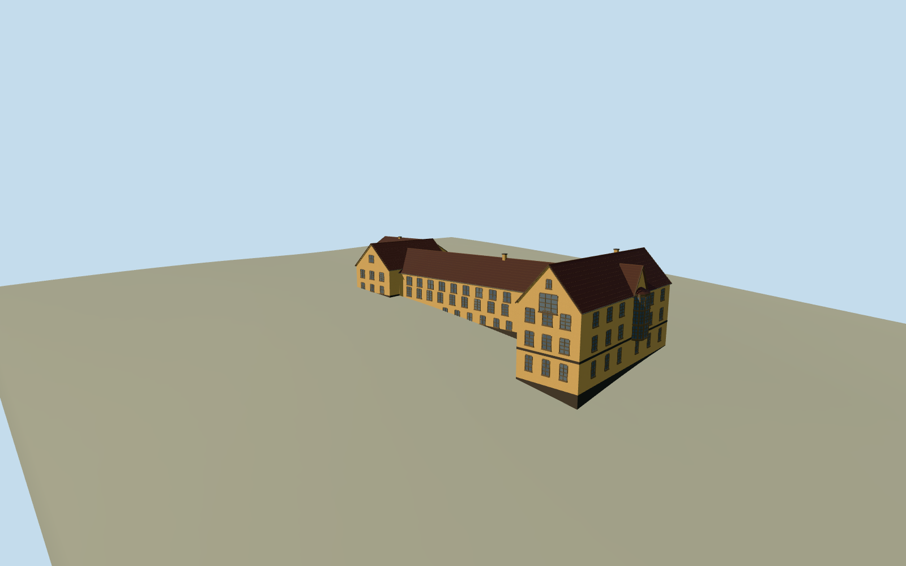

# Lundsberg School Main Building

Lundsberg’s National Romantic schoolhouse, with plaster walls, a granite footing and steep tiled gables.

Authoring state: **review-in-qa.json**. Current completion evidence is in [qa.json](qa.json) and the [completion ledger](../../../../qualla-structures/batches/qualla-004.PROGRESS.md).

- [Lundsbergs Boarding School](https://qualla.com/lundsbergs-boarding-school/)

The standing main schoolhouse is shown. The church and the detached campus buildings have separate footprints.

West and rear elevations, exact section heights and small window divisions are representative.

Build: `node content/worldgen/source/places/u6/u6d/lundsberg_school_main_building/models/generate-lundsberg-school-main-building.mjs`. Add `--check` to verify exact regeneration. 11648 triangles; 6 materials; no embedded photographs.
