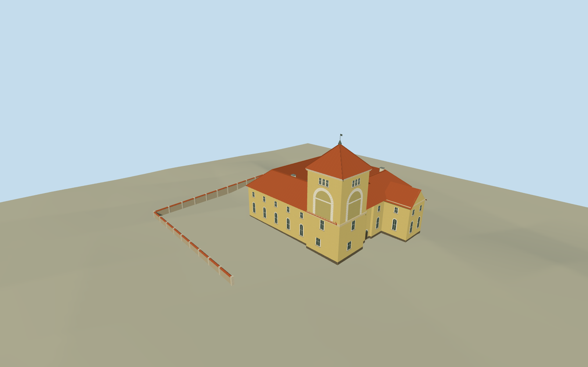

# Ventspils Castle

The ochre four-wing Livonian castle with tiled roofs, white blind arches, southeast tower and adjoining heritage wall.

Authoring state: **review-in-qa.json**. Current completion evidence is in [qa.json](qa.json) and the [completion ledger](../../../../qualla-structures/batches/qualla-004.PROGRESS.md).

- [Ventspils Castle](https://qualla.com/ventspils-castle/)

The current museum exterior, chapel and characteristic tower follow the historic quadrangle and original Qualla view. A number of small openings and rear facade details are estimated.

The current glazed cover is represented by an unobtrusive modeled roof. The courtyard interior and its collection are outside the exterior scope.

Build: `node content/worldgen/source/places/u6/u6p/ventspils_castle/models/generate-ventspils-castle.mjs`. Add `--check` to verify exact regeneration. 4236 triangles; 5 materials; no embedded photographs.
