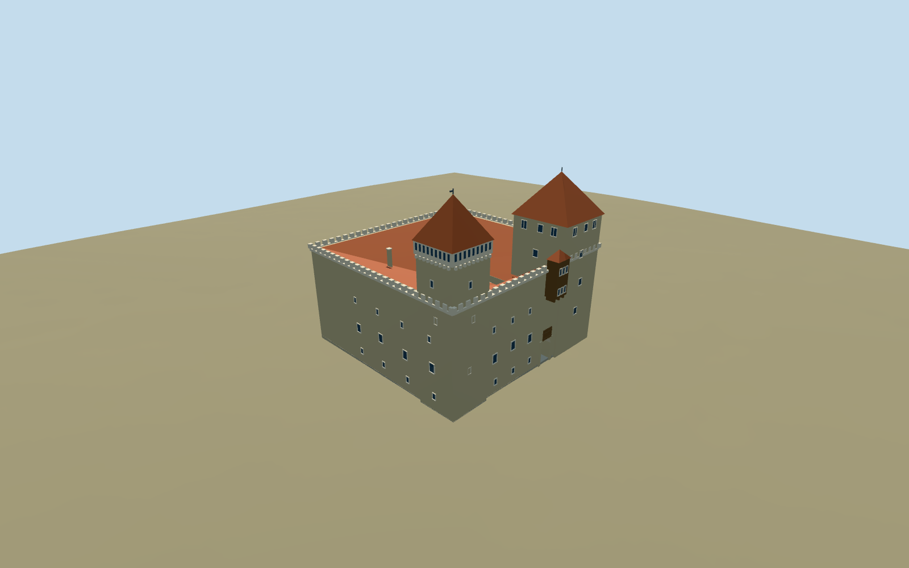

# Kuressaare Castle

Square dolomite convent building with a small open courtyard, broad red roof fields sloping inward, massive northern Sturvolt, slender eastern Tall Hermann, crenellated gallery and timber gate oriel.

## Evidence and reconstruction

Published dimensions and reconstructed details are separated in spec.json. Primary references:

- [Reference](https://linnus.samu.ee/en/about-the-castle/)
- [Reference](https://www.lumia.ee/en/projects/kuressaare-episcopal-castle)
- [Reference](https://www.kuressaarecastle.ee/)
- [Reference](https://whc.unesco.org/en/tentativelists/1716/)
- [Reference](https://www.openstreetmap.org/relation/414356)

No third-party geometry, photograph or bitmap texture is embedded. Shared surface graphs come from the central library; vertex tints carry model colors. Glazing uses PBR materials; transparent surfaces are declared per model.

## Model and axes

8,215 triangles; 24,645 vertices; 5 material groups; 989,068 bytes. Native bounds: -21.625, -2.089, -23.050 to 21.620, 38.800, 21.285. Source hash: `sha256:b255bd14d90f61dc49b3604a931d8e03fdf353bdcbff55d9122f9db12ba25b7e`.

{"up":"+Y","longitudinal":"+X east-southeast, 32.26 degrees south of east","front":"-Z northeast gate; Sturvolt at -X/-Z and Tall Hermann at +X/-Z","origin":"Site anchor; Y0 standard PMTiles working datum."}

Two inspected aerial pictures confirm the square stone convent, open court, inward-sloping red roofs, massive Sturvolt and slender Tall Hermann. Standard viewer PMTiles and cached building outline set location and signed tower/gate orientation. The flat site varies by less than1m at sampled corners; a reconstructed0.6m working rise and bounded foundation skirts clear that coarse surface. Anchor 22.479324007,58.246897902; heading -0.563076620916; standard PMTiles datum 9.787413303227948m. Floors are reconstructed and foundations extend below the coarse sampled ground.

## Reproduce

Run `node packages/worldgen/scripts/generate-signature-towers.mjs --ids=N0272` (or add `--check`). The generator preserves manually edited masters by checking their baseline hashes. Import through the standard authored-model workflow with optimization disabled; then capture all QA cameras, including shared-surface views.

## Pending work

- Pictures and standard viewer PMTiles define approximate current exterior fit; no bespoke surveys or exact thresholds.
- Detailed original architectural geometry and recipe remain unchanged. An independent derivative adjusts working datum and extends bounded foundation skirts.
- Square convent, open court, two contrasting towers, red roof fields, crenellated gallery and timber gate oriel provide identity. Openings, roof junctions, floor heights and carving remain approximate.
- This model covers the main convent building; surrounding star fort, moat, bridges, trees and navigable interiors remain outside its scope. No artificial hill or ground cutout.
- Four shared material graphs and local opaque glass; no embedded texture images. Physical-device timing and continuous-motion shimmer remain pending.

This bundle follows the medium-fi standard. Medium-fi appearance and geographic fit are reviewed separately. Hash-bound visual acceptance is recorded separately after capture inspection.

## Additional geographic data

© OpenStreetMap contributors, ODbL-1.0. Saaremaa Museum tour and LUMIA drawings/photos used as visual references only.
