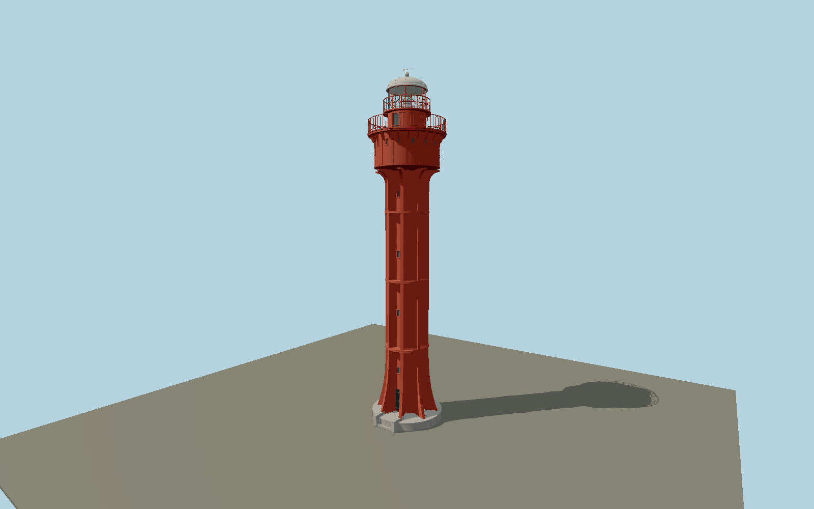

# Ristna Lighthouse — ristna_lighthouse

Bright red concrete-jacketed stair tube with eight full-height ribs, flared foot and upper supports, three horizontal braces, expanded riveted service room with sixteen small ports, scalloped gallery brackets, close picket rail, diamond-glazed lantern and white dome/vane.

## Identity and evidence

Exact catalog identity **Q3376573**. Source facts: `{"heightMeters":27.2,"focalHeightMeters":35.9,"serviceRoomDiameterMeters":5,"structuralRibs":8,"appearance":"Maintained red/white exterior; published authority text confirms restoration completion in summer 2026. Small details follow the genuine April 2026 Ristna close photograph and earlier records.","basis":"National aid 673 gives 27.2 m base-relative height and WGS84 location. Society archival 1925 elevation and sections identify eight concrete-jacketed ribs and three braces; cited industrial-heritage record gives a 5 m service drum. Genuine April 2026 Ristna photograph controls fittings, prior to repainting. July 2026 reopening article confirms works in text; its lead photograph depicts Mehikoorma and is excluded as a Ristna visual reference."}`. The source specification keeps published dimensions separate from reconstructed details.

- https://nma.transpordiamet.ee/aton/2844/
- https://www.etts.ee/tuletornide-nimekiri/ristna-tuletorn/
- https://www.etts.ee/wp-content/uploads/2023/09/ristna-4.jpg
- https://www.etts.ee/wp-content/uploads/2023/10/Ristna_tuletorn_2014.jpg
- https://westestonia.com/de/industrieerbe-tourismus/
- https://www.transpordiamet.ee/uudised/ehitustood-jatavad-ristna-tuletorni-kesksuveni-suletuks
- https://www.transpordiamet.ee/sites/default/files/2026-04/_MG_8067-15.jpg
- https://www.transpordiamet.ee/uudised/augustis-avavad-kulastajatele-uksed-kaks-uue-kuue-saanud-tuletorni

Original geometry and shared procedural materials. Official photographs are research references only; no reference imagery or third-party mesh is embedded or redistributed.

## Authored geometry and materials

68,696 triangles, 143,024 vertices, 5 surface groups; 5,976,396 source bytes. SHA-256: `sha256:d3328345835d0fc4183bba5a833628ac5c70f6a31c71a4b5f33b4bd23d5869a1`. Actual bounds: -3.010, 0.000, -3.010 to 3.010, 27.200, 3.040 m.

Shared canonical material graphs with metric UV repeats in extras.molenSurface; portable glTF PBR factors and vertex colors remain. Dark recesses/lantern panels retain local fallback materials. Shared references: `matgraph:molen.worldgen.material.plaster_lime` (2 × 2 m), `matgraph:molen.worldgen.material.metal_painted` (2 × 2 m), `matgraph:molen.worldgen.material.stone_granite` (2 × 2 m). Model-native axes: {"up":"+Y","front":"+Z","origin":"Authored main tower center at local base level; attached ensembles are offset from this origin."}.

## Placement proposal

Mapped road is station context; no mapped tower footprint or surveyed doorway azimuth is available. Aerial coastal/station arrangement supports the southeast door quadrant, not a precise bearing. National authority anchor is retained instead of the offset OSM point. Y=0 is host terrain contact; no surveyed foundation elevation, detached station buildings or shoreline is included. Public API returned 429 on 2026-10-09; this review uses the dated 2026-09-28 map snapshot. +Y up; +Z southeast and +X northeast. Entrance quadrant is reconstructed from the inspected 2014 aerial and archival site layout; the eight ribs retain 45-degree rotational symmetry. Proposed anchor 22.05526516, 58.9400605 (longitude, latitude), heading 0.7853981634 radians. Elevation policy: **terrain-contact**. This is a reviewable proposal, not a completed site-fit certification. Ground models require terrain contact; offshore models also require water-datum and base-height checks.

## Limitations and review

- The modeled exterior follows the cited published facts and inspected photographs. Unpublished dimensions and local fittings are explicitly photo-proportioned; no claim of engineering survey accuracy is made.
- Portable PBR and shared metric surfaces are provided. Surface weathering, material color under local lighting and fine facade relief require close render review before maximum-detail acceptance.
- Detailed exterior follows the documented post1920 concrete jacket, not the original1874 open iron frame. Published total height and5m service drum constrain a photographed/archival component reconstruction. Exact entrance azimuth and minor restored2026 vent fittings are not surveyed. Detached station buildings remain map structures.

Near/far fixtures are in `spec.qaCameras`. Float32 finite geometry, triangle degeneracy and winding are checked by the generator. Current rendering, shared-material, maximum-fidelity and geographic review results are recorded in `qa.json` and the readiness ledger; source generation alone does not approve a model.

Regenerate with `node packages/worldgen/scripts/generate-lighthouse-models.mjs --ids=ristna_lighthouse`; add `--check` for reproducibility. Editable component recipes are in `packages/worldgen/scripts/lighthouse-baltic-next-models.mjs`. The generator protects artist-edited master hashes and preserves import/capture/shared-capture/QA documents.
