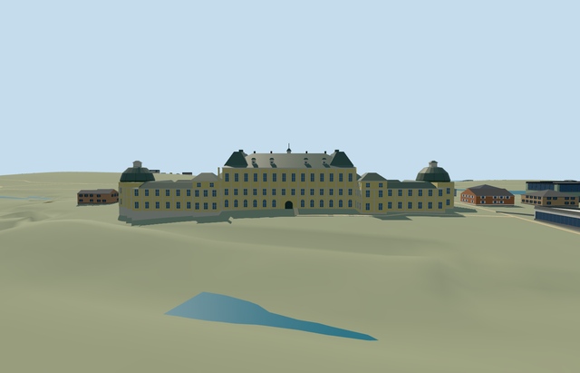

# drottningholm_palace — Drottningholm Palace

Reviewed2026-10-22. **Completed medium-fi connected exterior; approximate original-terrain placement.**

## Built and inspected

Complete mapped connected palace exterior: yellow rendered central block, cream pilasters/window surrounds/arched lake-side windows, tall green-gray hip roof/raised roof ends/dormers/chimneys and slender central lantern/mast. Lower ranges enclose two genuinely open courtyards; four intermediate pavilions and two domed ends. Real1.3m entrance recess, closed curved soffit/spandrels and threshold. In the same author/inspect/fix pass, corrected exposed wing caps to roof material, removed coplanar doorway faces and a pilaster crossing the entry, and lightened wall tint. Detached theater/outbuildings remain independent.

## Shared materials and browser LODs

Four existing256px shared graphs: plaster_lime pale-yellow render; stone_limestone_raw foundations/cornices/pilasters/sills; metal_painted green-gray sheet-roof/dome and pale frame/detail substitutes; storefront opaque blue-gray glazing. Painted metal substitutes for timber window frames; generic stone approximates dressed historic trim. No embedded image/private atlas/new material graph. Five textured draws/one skyline draw; linear tints, separate POSITION/NORMAL streams and equal CPU/GPU accounting. Each textured native run reads each graph once; unload releases all model geometry.

| Level | Triangles | Bytes | Draws |
| --- | ---: | ---: | ---: |
| skyline | 912 | 81028 | 1 |
| district | 2700 | 204352 | 5 |
| street | 8758 | 710748 | 5 |
| closeup | 8758 | 710748 | 5 |

Four authored LODs 912 / 2700 / 8758 / 8758 triangles within1k/4k/16k/64k caps. Initial skyline+district geometry 285380 bytes, shared cached material bakes separate. Six GLBs have zero Khronos errors/warnings;148 actual mesh/contact probes and6 actual PMTiles13/14/15 cases (two detailed fragments of one owned parent) pass. Inspected48 current portable/shared/medium-fi/native frames, all LODs, failure/loading lifecycle and Economy/High noon/late light. Physical device timings remain pending.

## Geographic placement

Q208559 and named palace POI on relation3182815/native52776561316063. Own only that parent, including both mapped courtyard holes;42 simple occupied strips express cutouts without unsupported holes fields. Own anchor[17.886770343504608,59.321694]22m east of candidate; internalX south-southeast/internalZ west-southwest; heading0, axes baked into native east/south geometry. Standard201x201/6m Mapzen grid retained unchanged, uncovered lake-side provider datum16.392013684797206m/floor0.7m. Boundary grades-3.447..+1.794m leave visible downhill foundations/slight uphill burial. Preserve82 resident/100 wider independent buildings, detached theater, roads and1,243,279.664464m² water. Both courtyards/approaches keep original ground. Failure keeps83 originals; all LOD unloads restore ground/water with zero live geometry. Approximate exterior fit only: exact terraces, shore platform, historic thresholds/accessibility remain unverified.

## Fidelity and limits

Medium-fi photo-led reconstruction of the mapped connected palace, not the entire royal park. No mapped heights: working central eave18.2m/roof25m, range9.5m/roof12.1m, four intermediate pavilions12.8m/roof16m, dome walls11.6m/lantern roofs21.8m, central roof lantern/mast30.1m above floor. Window/arch/pilaster/dormer/chimney counts, concealed court elevations, roof junctions and simplified lanterns are reconstructed. Skyline omits windows and flattens the entry; district reduces facade detail; street/closeup retain the curved recess. Shared painted-metal substitutes for sheet copper/frame timber, generic stone for trim. No furnished rooms, copied arms/statues/inscriptions/flag artwork or authored formal gardens. Native DEM/shore platform and accessibility remain approximate. Physical phone/laptop/dense-city timings pending.

## Targeted checks

Selected generation/import/placement, strict medium-fi, scene/sim30 and recipe lint pass. Sim30 sha256:6058820128236a59a5410c1b0d7d5af479384b1df501322fbb68177503f02faa. Pins: [qa.json](qa.json); [source controls](map-frame.json).

## Viewed references

- https://commons.wikimedia.org/wiki/File:Drottningholm_Palace_-_lakeside_frontage.jpg — Rosser1954 (rotation by Finavon); 2011-07-10 (description date); CC-BY-SA-3.0. Viewed only; no copied pixels.

- https://commons.wikimedia.org/wiki/File:Drottningholm_Palace_from_the_Garden.jpg — Allsong; uploaded2008-08-13; capture date unspecified; Public-domain (PD-self). Viewed only; no copied pixels.

- https://www.openstreetmap.org/relation/3182815 — original palace outline and two open courtyards, ©OpenStreetMap contributors ODbL-1.0. Standard PMTiles/Mapzen; no bespoke research.

## Completion checklist

- [x] Rebuildable source, import, four authored LODs and shared materials.
- [x] Current actual source/shared/native renders, geometry and lifecycle checks.
- [x] Unique mapped identity, signed orientation and approximate native exterior fit.
- [x] Both courtyards, all independent buildings, original roads/terrain/water retained.
