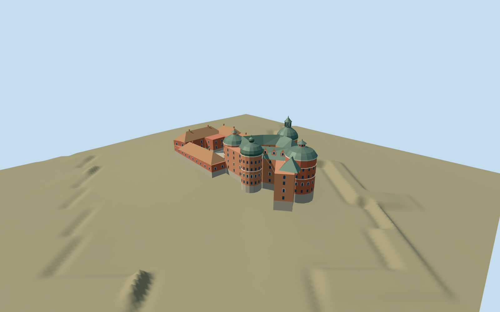

# Gripsholm Castle

Mapped Gripsholm brick castle with open inner and outer courts, four differentiated oxidized-copper tower caps, a tall open lantern, broad red helmet tower, onion cap, stepped brick dormers, low tiled wings and a real northwest entrance passage.

## Evidence and reconstruction

Published dimensions and reconstructed details are separated in spec.json. Primary references:

- [Reference](https://www.kungligaslotten.se/english/royal-palaces-and-sites/gripsholm-castle.html)
- [Reference](https://www.sfv.se/vara-fastigheter/sverige/sodermanlands-lan/gripsholms-slott)
- [Reference](https://www.kungligaslotten.se/download/18.7ce04b63167c576df6c18f72/1549446726603/Karta%20%C3%B6ver%20Gripsholms%20slott%20eng.pdf)
- [Reference](https://www.kungligaslotten.se/english/royal-palaces-and-sites/gripsholm-castle/visit-us/practical-information-access.html)
- [Reference](https://www.openstreetmap.org/relation/2848711)

No third-party geometry, photograph or bitmap texture is embedded. Shared surface graphs come from the central library; vertex tints carry model colors. Glazing uses PBR materials; transparent surfaces are declared per model.

## Model and axes

5,247 triangles; 15,741 vertices; 6 material groups; 633,368 bytes. Native bounds: -69.005, -4.957, -32.086 to 69.098, 44.000, 31.965. Source hash: `sha256:76a5ea01e166b1f3f09c6a15ab5464f2a8acd1db5ba20bde58b2cc44ff9d98f7`.

{"up":"+Y","longitudinal":"+X southeast from outer forecourt toward the four-tower core","front":"Outer entrance at-X northwest;lake-facing facades around the core;two courts remain open","origin":"Site anchor; Y0 standard PMTiles working datum."}

The inspected aerial picture confirms the brick castle, four different copper roof caps, open tall lantern, stepped dormers and lower tiled outer wings. Standard viewer PMTiles and the retained mapped building/courtyard outlines set approximate location, scale and northwest entrance/southeast core sign. A reconstructed2m working court clears coarse island ground; bounded foundations extend beneath sampled slopes. Exact shore and tower elevations remain approximate. Anchor 17.219554949,59.256010491; heading -0.787257418369; standard PMTiles datum 12.530517079873508m. Floors are reconstructed and foundations extend below the coarse sampled ground.

## Reproduce

Run `node packages/worldgen/scripts/generate-signature-towers.mjs --ids=N0279` (or add `--check`). The generator preserves manually edited masters by checking their baseline hashes. Import through the standard authored-model workflow with optimization disabled; then capture all QA cameras, including shared-surface views.

## Pending work

- Approximate current exterior from inspected picture and standard viewer PMTiles; no bespoke surveys or exact thresholds.
- Original detailed architectural master/recipe preserved; registered derivative fits working courts and bounded foundation bottoms.
- Four different copper roof silhouettes, open lantern, two open courts, stepped dormers and real northwest passage retain identity. Tower heights/cap dimensions reconstructed; no independent named-tower identification.
- Castle building compound only; island/lake terrain, drawbridge, remote estate buildings, boats, trees and interiors excluded.
- Five common material graphs and local opaque glass; six merged groups reflect the mixed compound. Zero embedded images. Physical-device timing pending.

This bundle follows the medium-fi standard. Medium-fi appearance and geographic fit are reviewed separately. Hash-bound visual acceptance is recorded separately after capture inspection.

## Additional geographic data

© OpenStreetMap contributors. The Royal Palaces/Swedish Royal Court and Statens Fastighetsverk primary references.
