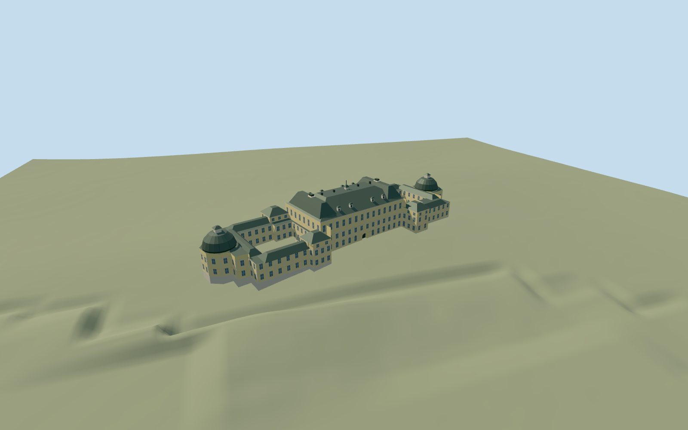

# Drottningholm Palace, main building and connected courtyard wings

Connected mapped exterior of Drottningholm Palace: pale-yellow rendered three-story central block, cream pilasters/window surrounds/arched lake-side ground openings, green-gray hipped central roof and raised roof pavilions, low courtyard wings, four intermediate pavilions, northern chapel dome and matching southern domed end. Preserve both mapped open courtyards and all independent theater/outbuildings. One actual recessed lake-side central doorway and simple threshold. No furnished rooms, copied coats of arms, flag graphics, statues or garden reconstruction.

## Evidence and reconstruction

Published dimensions and reconstructed details are separated in spec.json. Primary references:

- [Reference](https://commons.wikimedia.org/wiki/File:Drottningholm_Palace_-_lakeside_frontage.jpg)
- [Reference](https://commons.wikimedia.org/wiki/File:Drottningholm_Palace_from_the_Garden.jpg)

Connected mapped exterior of Drottningholm Palace: pale-yellow rendered three-story central block, cream pilasters/window surrounds/arched lake-side ground openings, green-gray hipped central roof and raised roof pavilions, low courtyard wings, four intermediate pavilions, northern chapel dome and matching southern domed end. Preserve both mapped open courtyards and all independent theater/outbuildings. One actual recessed lake-side central doorway and simple threshold. No furnished rooms, copied coats of arms, flag graphics, statues or garden reconstruction.

## Model and axes

8,758 triangles; 22,530 vertices; 5 material groups; 919,636 bytes. Native bounds: -40.998, -3.597, -72.872 to 47.230, 30.800, 80.810. Source hash: `sha256:c6782cc597a6833702077802db9ec31a635fdfebc257127f8e38c6e7eac29816`.

{"x":"east","y":"up","z":"south"}

The geographic proposal uses exact-QID OpenStreetMap evidence. Map-derived orientation and estimated architectural details require real-site visual review; preview eligibility is distinct from geographic/fidelity approval. Map attribution: © OpenStreetMap contributors, ODbL-1.0.

## Reproduce

Run `node packages/worldgen/scripts/generate-additional-landmarks.mjs --ids=N0756` (or add `--check`). The generator preserves manually edited masters by checking their baseline hashes. Import through the standard authored-model workflow with optimization disabled; then capture all QA cameras, including shared-surface views.

## Pending work

- Connected mapped exterior of Drottningholm Palace: pale-yellow rendered three-story central block, cream pilasters/window surrounds/arched lake-side ground openings, green-gray hipped central roof and raised roof pavilions, low courtyard wings, four intermediate pavilions, northern chapel dome and matching southern domed end. Preserve both mapped open courtyards and all independent theater/outbuildings. One actual recessed lake-side central doorway and simple threshold. No furnished rooms, copied coats of arms, flag graphics, statues or garden reconstruction.
- Q208559 and named palace POI on relation3182815/native52776561316063 identify one connected courtyard palace. Own this parent only. Shifted anchor22m east of candidate; internalX follows the mapped south-southeast facade axis, internalZ points west-southwest toward the garden. Heading0; native east/south geometry has the signed axes baked in. Original outer ring and two courtyard holes determine occupied floors and replacement. The detached theater way23519174 and other pavilions remain independent map context.
- No height is tagged on this map parent. Two ordinary exterior photos guide relative proportions: working main eave18.2m/roof25m, low range eave9.5m/roof12.1m, four intermediate pavilions12.8m/roof16m, domed end walls11.6m/roof21.3m, small central roof lantern/mast30.1m. Window/pilaster/dormer/chimney inventories, unseen courtyard elevations and roofs reconstructed. Existing plaster_lime, stone_limestone_raw, metal_painted and storefront graphs. Painted metal substitutes for glazed window frames/wood and green sheet-copper roofs; no new material graph/private atlas/copied pixels.
- Standard Protomaps20261020 plus original MapzenTerrarium201x201/6m grid. Uncovered lake-side approach fixes datum16.392013684797206m; working floor0.7m above provider. Only mapped occupied palace floors cut ground; retain both courtyard holes, roads/lake and all independent buildings. Approximate native exterior fit inspected on the original grid: boundary grades-3.447..+1.794m leave visible downhill foundations and some uphill burial. Exact historic terraces, steps, shoreline platform and accessibility remain unverified. No bespoke terrain research or custom terrain flattening.

This bundle follows the medium-fi standard. Medium-fi appearance and geographic fit are reviewed separately. Hash-bound visual acceptance is recorded separately after capture inspection.
