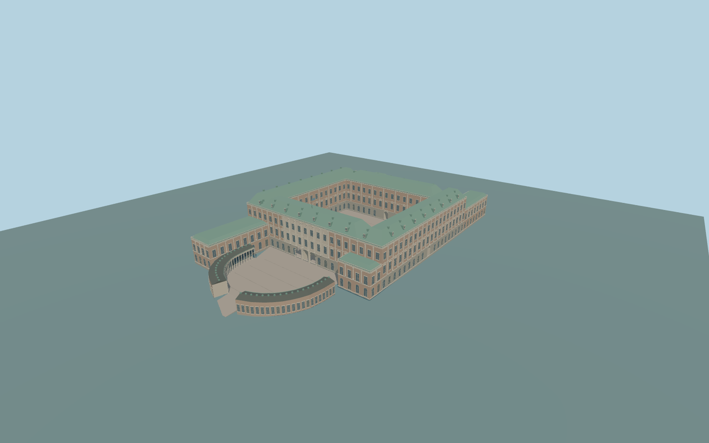

# Stockholm Palace

Complete individual principal palace/one open inner court,green copper roof ring/dormers,north lower terrace,three longer andone short projecting wings,andboth separately mapped curved west guard ranges withreal open column galleries/dark roofs. Main west three-portal entrance andcentral court passages remain open. Independent Storkyrkan/city buildings,waterfront roads,water andLogarden garden remain native context.

Rebuild: `node packages/worldgen/scripts/generate-stockholm-palace.mjs`;append `--check` for exact source bytes. Select import/LOD/placement with `--ids=stockholm_palace`. Detailed source and four browser tiers are separate ignored GLB outputs.

Complete individual principal palace/one open inner court,green copper roof ring/dormers,north lower terrace,three longer andone short projecting wings,andboth separately mapped curved west guard ranges withreal open column galleries/dark roofs. Main west three-portal entrance andcentral court passages remain open. Independent Storkyrkan/city buildings,waterfront roads,water andLogarden garden remain native context.

Main four-wing quadrangle uses the individual map envelope andsingle actual open court. Curved guard outlines/inner/outer chains follow actual PMTiles components;their front colonnades are real open galleries before closed back rooms. Principal main-court ground arches are closed doors/glazing except original central passages. Original roof dormers,facade relief panels,columns andvent/chimney abstractions;no copied sculpture/lettering. Lower north terrace andprojecting wings retain their relative levels.

Approximate26m reference withunchanged193x193/2m/384m standard viewer Terrarium field(one tile). Common inner/west guard paving+1m(27m sea-level) andphoto-proportional eaves/roofs are original approximations,not surveyed. Main eave28.3m/roof36m above paving,projecting eave17.5m,guard eave8.5m. Resident-only bounded ground clip clears urban DEM/native paving within the owned palace andprecise curved guard-court paving;outside terrain/garden/roads remain native. Foundations reach raw field;coarse historic grades andthresholds remain approximate. A bounded west approach ramp meets the unchanged coarse field at-129m andthe actual guard-court opening;it is an original grade adaptation,not surveyed access.

Three ordinary aerial/west-guard/inner-court pictures andstandard PMTiles/global terrain only. Fine statue/window/dormer inventories,hidden roof details,unseen portal assignments andhistoric grades are original approximations. Optical room interiors excluded. Adjacent church/city andwider gardens excluded. No private/embedded images orbespoke archive/survey research. Physical laptop/phone/dense-city timing unmeasured.

Six existing256px plaster,limestone,granite,painted-metal,window-grid andpainted-wood graphs;metric UVs/linear colors. Skyline preserves main open court,hipped roof ring,projecting wings,lower northern terrace,open portals andcoarse curved colonnades. District adds sparse glazing/dormers. Street adds regular facade rhythms andlightweight frame strips. Close-up adds round columns,frames,roof rails,vents andseated dormers/chimneys. Master preserves dense profiles andframe geometry. Error estimates3/1.5/.7/.25m are unmeasured approximations;physical timing unmeasured.

Original geometry:repository license. Map:© OpenStreetMap contributors,ODbL-1.0;Protomaps. Standard terrain:terrain-grid.json. Ordinary pictures stay local and are not redistributed or used as textures. Current acceptance:qa.json.
