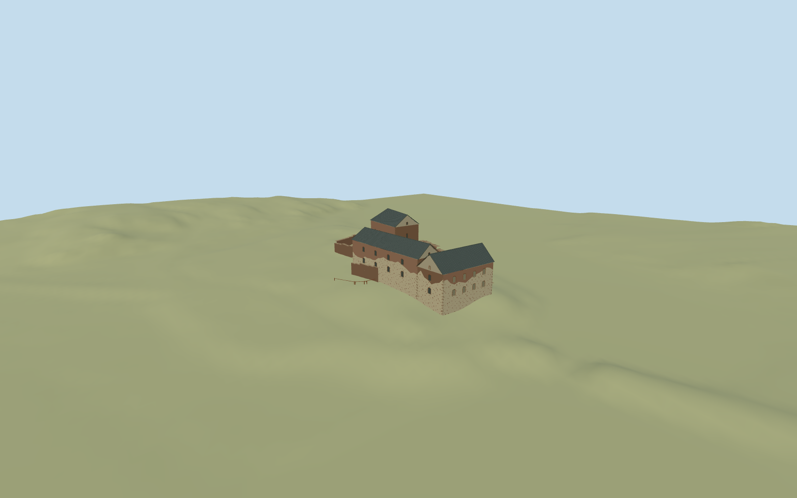

# Kastelholm Castle

Gabled stone ranges, restored Kuretornet and the two walled courts of Kastelholm Castle on Åland.

Authoring state: **review-in-qa.json**. Current completion evidence is in [qa.json](qa.json) and the [completion ledger](../../../../qualla-structures/batches/qualla-003.PROGRESS.md).

- [Kastelholm Castle](https://qualla.com/kastelholm-castle/)

This is the standing conserved castle. Northern range and keep silhouettes follow the exact original public-domain photographs and published measurements. Unroofed wall heights, courtyard boundaries and the length of individual restored roof sections are approximate.

The view shows several periods of surviving red granite and lime render. Masonry scars, shutter placements and the east entrance are simplified.

The original bare-earth terrain is retained. The ancient full moat, lost upper walls and historical interior reconstruction are outside this scope.

Build: `node content/worldgen/source/places/u6/u6w/kastelholm_castle/models/generate-kastelholm-castle.mjs`. Add `--check` to verify exact regeneration. 17302 triangles; 8 materials; no embedded photographs.
