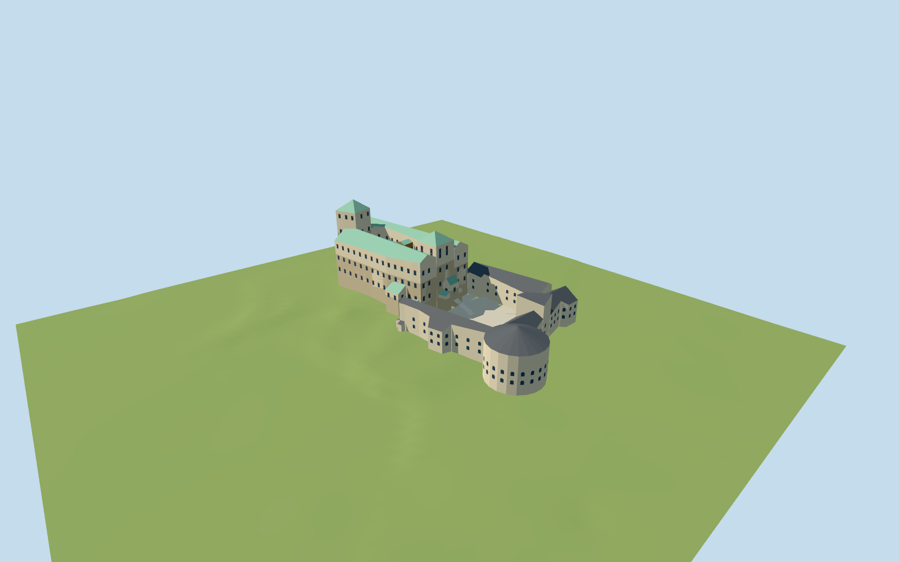

# Turku Castle

Current Turku Castle: west38m/east32m rectangular towers, pitched green copper main wings around two open courts and an elevated timber/glass gallery; white bailey/grey metal roofs, southeast round tower, lower annexes and three actual arched entrance passages.

## Evidence and reconstruction

Published dimensions and reconstructed details are separated in spec.json. Primary references:

- [Reference](https://api.openstreetmap.org/api/0.6/map?bbox=22.2253,60.4338,22.2315,60.4370)
- [Reference](https://turunlinna.fi/en/home-page/)
- [Reference](https://turunlinna.fi/sv/abo-slotts-historia/)
- [Reference](https://turunlinna.fi/en/getting-here/)
- [Reference](https://turunlinna.fi/wp-content/uploads/2025/02/Turun-linna009-Ania-Padzik.jpg)
- [Reference](https://turunlinna.fi/wp-content/uploads/2024/10/Turun-linnan-paalinnan-sisapiha-Henri-Taponen-Turun-kaupunki-WP.jpg)
- [Reference](https://www.vikingline.de/globalassets/images/destinations/finland/activities/turku-castle/aerial-view-turku-castle-visitturku-812x501.jpg)
- [Reference](https://kaupunkisuunnittelu.turku.fi/kaavoitus/5661-2019Yleisotilaisuusesitys2023ID11290-Valmisteluehdotus.pdf)

Seven existing shared256-square stone/lime plaster/copper/painted metal/timber/brick/gravel graphs with metric repeats and linear tints; flat glass. No embedded/new image, copied mesh or photo texture.

## Model and axes

6,954 triangles; 20,862 vertices; 8 material groups; 839,136 bytes. Native bounds: -70.559, -1.311, -33.523 to 70.894, 42.572, 32.784. Source hash: `sha256:a60704ec23541c779b3f323057000d16c6be37de99c5644437f97ae408091e9e`.

{"up":"+Y","longitudinal":"Native+X east,+Z south, current WGS84 component traces; runtime heading0.","origin":"Original horizontal map anchor; local Y0=4m N2000 reconstructed bailey datum. Upper courts8.572m from City of Turku inner-court height point. Signed +X East/+Z South and heading0."}

Native+X East,+Z South and heading0 retain all attributed mapped parts. Source-local city heights establish8.572m N2000 in the inner court; lower bailey4m is reconstructed and not claimed measured. Sparse interpolated review terrain and foundations are included; host terrain resolution/datum agreement controls final ground fit.

## Reproduce

Run `node packages/worldgen/scripts/generate-signature-towers.mjs --ids=turku_castle` (or add `--check`). The generator preserves manually edited masters by checking their baseline hashes. Import through the standard authored-model workflow with optimization disabled; then capture all QA cameras, including shared-surface views.

## Pending work

- Current medium-fi exterior reconstructs architectural sections from operator photos and original attributed17part map traces. Official west/east totals38/32m are kept relative to upper court; exact height datums, roof pitches, windows and plaster shapes are not surveys.
- Measured city inner-court height8.572m N2000 anchors both adjoining upper courts. Lower bailey4m, eastern stair dimensions and between-observation grades are original reconstruction; no interior bailey city height point was returned.
- The source terrain is an original4m grid interpolation of27 city spot heights and107 contour fragments, with explicit court constraints. It is not a downloaded official DTM. Host terrain needs compatible N2000 datum and adequate local resolution.
- Foundations extend below interpolated ground and the three passage openings remain visible. No interior navigation or walkable collision certification. Western approach/ramp and current harbour street works are outside this landmark scope.
- Seven existing shared256-square irregular stone, lime plaster, copper, painted metal, wood, brick and gravel graphs; opaque local glass. Flat far stone uses the current graph mean and retains coarse plaster coverage. No new, embedded or photographic texture.
- Nearby cottages/warehouses, park vegetation, natural rock microdetail, port development, interior exhibits, heraldry, exact painted ornaments and window grids are excluded. Operator photographs and planning aerial remain private research references.
- Physical phone/laptop timing and downtown memory are unmeasured; browser byte, triangle, draw and unloading checks are separate from physical-device validation.

This bundle follows the medium-fi standard. Medium-fi appearance and geographic fit are reviewed separately. Hash-bound visual acceptance is recorded separately after capture inspection.

## Additional geographic data

© OpenStreetMap contributors; City of Turku/Turku Castle Museum/Ania Padzik/Henri Taponen; VisitTurku; City of Turku/Terratec Oy.
