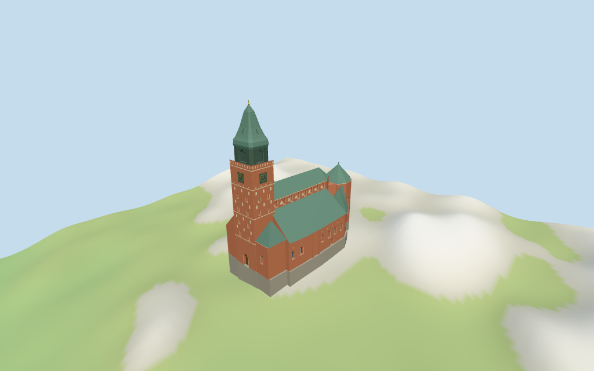

# turku_cathedral — Turku Cathedral review

Reviewed 2026-10-14 against current source/runtime bytes. Accepted for the recorded medium-fi exterior and approximate geographic scope.

## Built result

Inspected all 11 final portable/source-terrain views. Individual western brick clock tower, pale band/patch/blind-niche rhythms, dark closed upper belfry, flared green copper spire with closed narrow roof-light marks and gold ball/cross, long clerestory/main gabled roof, broad lower aisle roofs, projecting northern chapel, rounded northeast chapel, southern additions and polygonal eastern choir are present. Selected windows and west/south portals have closed recessed backing. Removed southern tower windows hidden by the chapel roof and refined the tapered spire tip. Finials and ornament are restrained approximations.

Individual medium-fi exterior from two useful elevated-tower/whole-south pictures and standard viewer PMTiles/DEM. Intermediate eaves, sloping roof fields, wall/roof subdivisions, selected windows/closed doors, pale decorative niches/clock faces, upper shutter fields, tapered copper profile/closed roof lights and the small 1.8m choir finial are picture-led estimates. Roof planes are reconstructed surfaces rather than flat extruded map parts. Exact plaster/brick weathering, sculpture, full interiors, adjacent city/plaza and certified walking are excluded. Upper belfry fields and narrow roof lights are closed; no bell interior or open lantern is claimed. Physical phone/laptop measurements remain pending.

## Shared materials and placement

Inspected all 11 final shared-material/geographic views. Five existing 256-square graphs supply Flemish brick, raw limestone, granite, copper and plain wood. Green roofs, dark belfry and gold metal share the copper graph with separate linear tints; pale patches/niches share limestone. Glazing is flat blue-gray. Metric UVs use the central repeat sizes; a current imported wall edge measures 0.6m per vertical Flemish-brick repeat. At distance the fine brick courses fade. Each graph reads once. Unloading disposes geometry, leaves zero live model geometries and restores ground. Flat placement compares the signed footprint; source-terrain views complement coarse DEM contact. Ground colors are diagnostic.

Retained exact-QID way437169589 and 36 current PMTiles cathedral/part controls preserve the approximately 88.75x50.36m envelope without rescaling. Anchor [22.278491799,60.452447201], heading -0.054920877897rad: native-X faces the western tower, native+X the eastern polygonal choir, native-Z the projecting north chapel and native+Z the long south aisle. Raw transforms match; nave and north wall plans exactly equal the recorded roof unions. Current tower 55/64/67/73/85m stages, nave 42m, choir 30/40m and selected lower-roof maxima/intervals guide the geometry. Main 35m/northeast 24.4m eaves and roof slopes are estimates. The retained 101.9m fact has an uncertain datum and is not treated as an additional tower height. Standard DEM datum 40.297409m, estimated 2.1m floor and sampled footprint peak 1.729m give approximate contact. All 240 current viewer footprint checks retain 36 controls and preserve three nearby buildings/west plaza across all six outputs. Exact altitude, plaza/door thresholds and walking fit are unverified; no road replacement.

Inspected all 27 final Earth-lighting views: Economy/High, noon/late, three distances, silhouette, six details, four matched whole-model levels and four transitions. Skyline preserves stepped tower/roof/choir masses and the main spire. District adds shared graphs, selected flat glazing/doors, pale niche/patch rhythms and clocks. Street adds real window/closed-portal and upper-shutter recesses. Closeup/master refine clock ticks, selected window bars, shutter slats and metal curves. Curvature, aperture and ornament changes remain visible. Matched cameras show the whole model; street/detail views crop intentionally. Swedish-cottage neighbors are synthetic context, not local map buildings.

## Browser budgets

| Level | Triangles | Bytes | Draws |
| --- | ---: | ---: | ---: |
| skyline | 846 | 86496 | 1 |
| district | 2671 | 267256 | 8 |
| street | 6647 | 680756 | 8 |
| closeup | 9515 | 974244 | 8 |

Skyline plus district: **353752 bytes** of geometry. Source master: **1146504 bytes / 9515 triangles**. Five graphs cached separately; no embedded images. Initial geometry excludes graph definitions/texture generation. Separate POSITION/NORMAL streams have equal CPU/GPU buffer totals. Physical device timings pending.

## Verification

- Targeted source reproduction: generate-additional-landmarks.mjs --ids=turku_cathedral --check. Current source/import/derivative/review hashes match.
- Six GLBs pass Khronos with zero errors, warnings or embedded images. Four browser levels meet triangle/draw/download budgets.
- 36 raw current map controls, retained exact-QID outline, signed frame and standard DEM match. Derived nave/north unions match exactly. All six outputs retain the mapped 85m overall top above the estimated floor.
- **514 imported geometry probes** pass: main/aisle/chapel/choir roofs, spire/cross and detailed clear window/closed-door/shutter recesses with backing.
- **240 actual viewer footprint checks** pass: 36 selected map controls covered, three neighboring buildings/west plaza preserved across six outputs.
- Five graphs read once; unloading disposes geometry and restores ground. Current imported brick UV repeat matches the library.
- Source inventory/schema, map-frame and medium-fi readiness bindings pass.
- Scene validation/30-tick simulation pass: sha256:4469b40641700f22a9a84e400f847ebc0b97cc42f16efbb626ae7c8c78dbdca6.
- Inspected **49 current frames**: 11 portable,11 shared/placement,27 medium-fi. Reports retain paths, cameras and hashes; bulk views remain local/ignored.

Source hash: sha256:9af99423276080968726eaf543e0a8bef7b5ba57636dc2e72df3a1ee958a6c0d. Runtime hash: sha256:42bd25bae707a4b8ca3e36cb58ccf8bd09905c83ab542527a859986ac0193655. Input hash: sha256:1755c85613729a7f1b01b5bb016de8bd46157939e1e7e197bba3e37832eb83b5.

Commands: targeted generate/import/LOD; capture-structure-models.mjs --ids=turku_cathedral --reflections --antialias --fit-shadows; capture-landmark-library.mjs --ids=turku_cathedral --reflections --adaptive-clipping --bounded-placement; capture-medium-fi.mjs --ids=turku_cathedral --reflections; molen validate; molen sim run --ticks 30 --hash. No repository-wide engine suite/audit or full source rebuild repeated; next routine source checkpoint follows transfiguration_cathedral.

## Limits

- Exact-QID way437169589 retains approximately88.75x50.36m full envelope;36 current cathedral/part controls retain tower55/64/67/73/85m stages,nave42m,choir30/40m,northeast chapel34.61m,aisles16/30m,southwest chapel18.3/28.6m,southeast chapel16.1/29.7m and east annex17/29.36m intervals. Raw polygons retained,with nave/north range unions recorded. Intermediate eaves/roof slopes and openings are picture-led estimates. Retained101.9m fact has an unclear height datum and is not substituted for the current85m mapped spire;absolute altitude is unverified. No bespoke survey.
- Standard DEM datum 40.297409m;estimated floor 2.1m clears sampled footprint peak 1.729m and perimeter -10.29..0.98m. Foundation follows coarse terrain. Absolute altitude/exact plaza/portal thresholds remain approximate;no independent survey or certified walking.
- Individual medium-fi exterior from two useful tower/whole-south pictures and standard viewer PMTiles/DEM. Main eave35m and northeast eave24.4m,sloping roof fields,wall/roof subdivisions,selected windows/closed doors,pale blind niches/clock marks,upper shutter fields,spire profile/closed roof-light marks and small1.8m choir finial are estimated. Exact plaster/brick weathering,sculpture,full interiors,adjacent city/plaza and certified walking excluded. Large belfry fields and small roof lights are closed;no bell interior claimed. Physical phone/laptop timings pending.
- Skyline preserves the complete stepped roof/tower/choir silhouette and estimated supporting volumes. District adds shared graphs,selected glazing/doors,pale patch/niche rhythms and clocks. Street opens real glazing/closed-door and upper-shutter recesses. Closeup/master refine clock ticks,selected window bars and shutter slats. Curvature,aperture and ornament changes remain visible.

Readiness accepts this exterior scope. The 1,000-candidate goal remains incomplete.
