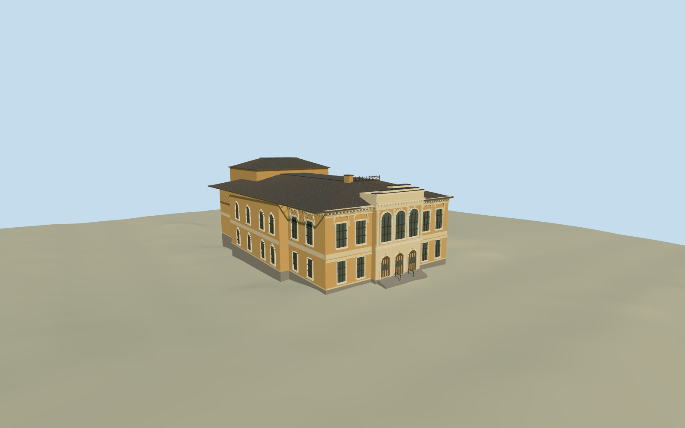

# Pori Theatre

Historic Pori Theatre with the three-arched Hallituskatu façade, pale ochre side wings and tall rear stagehouse.

Authoring state: **review-in-qa.json**. Current completion evidence is in [qa.json](qa.json) and the [completion ledger](../../../../qualla-structures/batches/qualla-004.PROGRESS.md).

- [Pori Theatre](https://qualla.com/pori-theatre/)

Standing historic theatre and stagehouse. The modern 1974 theatre annex and interiors are outside scope.

Historic front details follow the primary photo. Rear fenestration, exact roof junctions and small ornamental patterns are representative.

Build: `node content/worldgen/source/places/u6/u6z/pori_theatre/models/generate-pori-theatre.mjs`. Add `--check` to verify exact regeneration. 9386 triangles; 7 materials; no embedded photographs.
