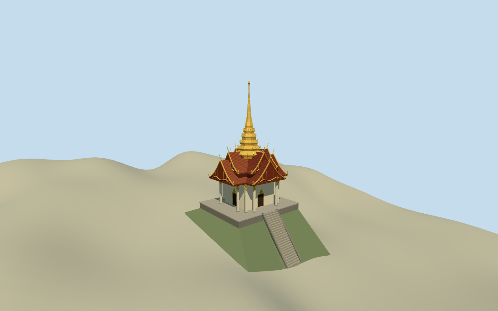

# King Chulalongkorn Memorial Building

Utanede’s royal Thai pavilion with its stone terrace, white colonnade, red cross-gables and gilt spire.

Authoring state: **review-in-qa.json**. Current completion evidence is in [qa.json](qa.json) and the [completion ledger](../../../../qualla-structures/batches/qualla-004.PROGRESS.md).

- [King Chulalongkorn Memorial Building](https://qualla.com/king-chulalongkorn-memorial-building/)

The exterior proportions follow the photographs and the documented overall height. Gilded relief is simplified and exact rear trim details are estimated. Only the pavilion and its stone terrace are modeled.

Build: `node content/worldgen/source/places/u7/u75/king_chulalongkorn_memorial_building/models/generate-king-chulalongkorn-memorial-building.mjs`. Add `--check` to verify exact regeneration. 9494 triangles; 7 materials; no embedded photographs.
