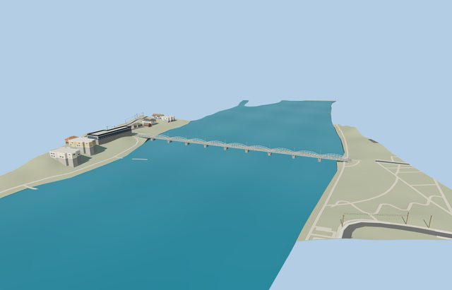

# Gamla bron — completed medium-fi and native placement pass

Reviewed 2026-10-25. **Complete scoped bridge exterior of the observed 2023 form. Host terrain and bank attachment remain approximate.**

## Geometry and surfaces

Inspected 48 current frames in one author/inspect/fix pass: 9 portable, 9 shared, 21 medium-fi and 9 native. Ten paired shallow bowstrings, clear river openings, continuous deck, open steel trestles, rounded masonry piers, three-bar rails, downstream utility main and pole line match the observed 2023 exterior. The skyline end pavement cap, rear near-LOD trestle bracing and small return pipe were corrected during this pass. Source and canonical runtime masters retain their exact original bytes.

Three existing 256px shared material graphs: metal_painted, stone_granite and wood_plain. District/street/closeup use three draws; skyline uses baked vertex colors and one draw. Wood grain follows the transverse boards and vertical poles. No private atlas, embedded images, copied photo pixels or new texture library entries. Model graphs are read once each, position/normal streams are separate and model/support geometry releases on unload.

| Level | Triangles | Bytes | Draws |
| --- | ---: | ---: | ---: |
| skyline | 944 | 75020 | 1 |
| district | 3168 | 228744 | 3 |
| street | 15640 | 1162436 | 3 |
| closeup | 43512 | 3333324 | 3 |

Four authored LODs: 944/3168/15640/43512 triangles; initial skyline + district 303764 bytes. Lower levels deliberately drop sub-pixel wires, fasteners and stone relief; the ten-span crossing, deck, piers and open supports remain. Skyline/district declare 5.3 m error to account for omitted tall narrow pole lines. Source master remains 156,768 triangles. Current economy/high, noon/late, near/far and transitions inspected. Physical phone/laptop measurements remain pending.

## Native fit

Approximate native fit approved at [20.24908069,63.824875538], signed heading 1.266401710014: +X NNE to the city, +Z ESE on the pipe/pole side. The 301 m nominal superstructure and 309 m full envelope remain distinct. The prior sea-level-zero placement was buried in standard terrain. The south mapped cycleway landing now supplies the host terrain reference at model deck Y=5.8, placing this fixture foot at 13.7890 m and deck at 19.5890 m. Both current native bank views are continuous; sampled road joins remain within 0.12 m of deck. Coarse terrain, river stage, equal pier stationing and exact bank grading are reconstructed visualization, not surveyed engineering levels.

Native Molen loads every runtime LOD and handles model failure. All 18 resident buildings remain; no mapped building is replaced. The overlapping bridge cycleway and tiny directly connected end fragments are clipped to the authored pavement. Only connected approach profiles receive height hints/supports. All unrelated road lines, every original DEM sample, native river geometry and shoreline behavior remain. Original source roads are immutable. Failed load retains the full mapped crossing without inferred support geometry. Unload restores native content and releases model and retaining-support geometries.

## Checks

Targeted source generator --check, strict medium-fi, scene validation and 30-tick simulation passed. Six GLBs have zero Khronos errors/warnings; 436 mesh probes pass. All 48 current frames were inspected and checked against current hashes. Exact model, scene and engine pins are retained in qa.json. Bulk captures stay local. No global source rebuild, full engine CI or npm audit was run for this model.

## Reference and limits

Ordinary [2023 photograph by Axel Pettersson](https://commons.wikimedia.org/wiki/File:Gamla_bron,_Ume%C3%A5,_2023-10-16,_fr%C3%A5n_sidan.jpg), CC BY 4.0, viewed only. Existing dimensional references were retained without bespoke re-research. Standard 2026-10-20 Protomaps and Mapzen inputs remain unmodified. Source inputs and limitations are in reference-metadata.json, native-fit.json and review-scope.json. Physical laptop and phone measurements remain pending.
