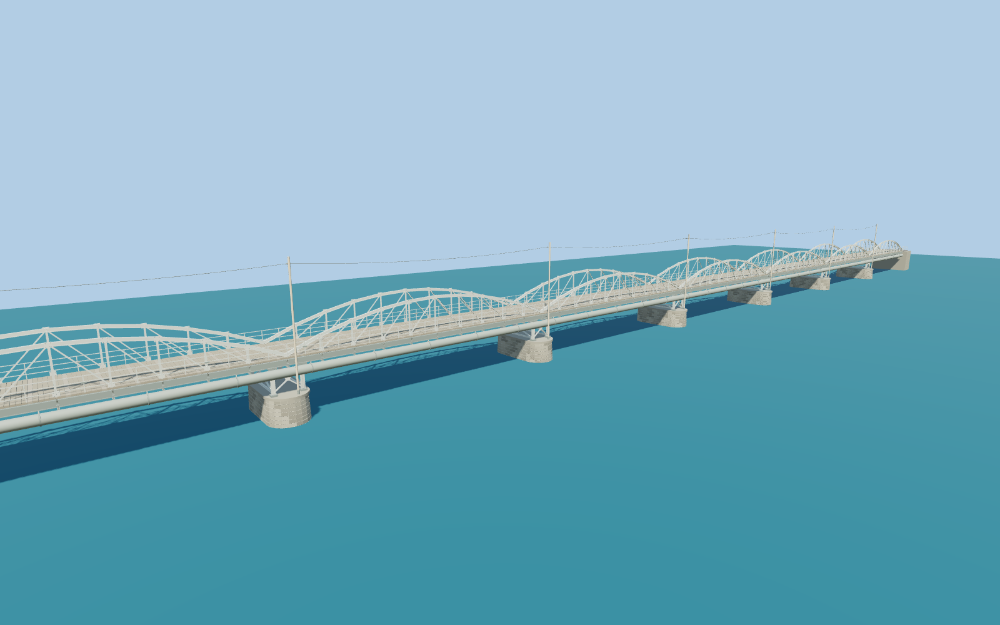

# Gamla bron, Umeå — gamla_bron

Ten shallow polygonal bowstring steel-truss spans above a narrow pedestrian deck, carried on open X-braced steel trestles and coursed masonry piers; riveted structural flanges, deck joists, three-bar parapets, the visible utility main, pole line and low lighting fittings.

## Identity and evidence

This is **Wikidata Q3603782**, the old bridge in Umeå, Sweden. The municipality dates its opening to 1863. The heritage inventory records **301 m and ten spans**; the current steel structure dates to 1894–1895. Original 2023 and municipal 2022 photographs establish the shallow polygonal bowstring trusses **above** the deck, open steel trestles, rounded masonry piers, utility pipe and pole line.

The exact-identity OSM outline has a **309.007 × 6.695 m envelope**. That envelope is retained separately from the nominal 301 m structural length. This model divides the published structure into ten equal 30.1 m spans and adds compact abutments to a 309 m full extent; the published structural length and mapped envelope remain distinct; the short abutment extensions are a photographic reconstruction.

## Original geometry

Authored in `content/worldgen/source/places/u7/u7q/gamla_bron/models/gamla-bron-model.mjs`: paired bowstrings and lattice webs, built-up I-section chords and trestles, gussets and bolt heads, deck boards and joists, three-bar railings, masonry course seams, pipe collars and brackets, utility poles and wire, and low lighting fittings.

156,768 source triangles; 292,148 vertices; 6 material groups; 12,402,144 bytes. SHA-256: `sha256:5eed00e4226f063f6e80b67517271c8874a8ddd3be04c9c87fc366b80742dd55`. Actual bounds: -154.500, -0.012, -4.225 to 154.500, 14.200, 4.225 m.

Up +Y, bridge length +X, transverse +Z. Origin is the horizontal midpoint of the nominal span system. **Y=0 is the reconstructed exposed-pier/river surface**, with the viewer height now referenced to the mapped south deck landing through terrainReference.modelHeight=5.8. Native +X faces NNE toward the city bank, and +Z carries the downstream ESE pipe and pole line. Seasonal river level and exact bank grading depend on host data. The former sea-level-zero placement was buried by the standard terrain; the current host-relative attachment avoids that. Nearby buildings and unrelated roads remain independent.

## Sources and rights

- https://lm.umea.se/namnkarta/poi/169FBA25/GamlaBron
- https://cust.kulturhotell.se/c57/files/original/d159921d56a1108490233d10d341a16a.pdf
- https://www.designatljus.eu/projekt/gamla-bron-umea
- https://via.tt.se/pressmeddelande/3317479/gamla-bron-i-umea-tands-upp-i-ukrainas-farger?publisherId=1422393
- https://commons.wikimedia.org/wiki/File:Gamla_bron,_Ume%C3%A5,_2023-10-16,_fr%C3%A5n_sidan.jpg
- https://commons.wikimedia.org/wiki/File:Gamla_bron_Ume%C3%A5_2007-06-24.jpg
- https://www.openstreetmap.org/way/454463632

The 2023 original photograph is by Axel Pettersson (CC BY 4.0); the 2007 photograph is by Mikael Lindmark (CC BY-SA 2.5). Both are visual research references, with no photographic content embedded or redistributed. Municipal and contractor references retain their own rights. OSM dimensional evidence © OpenStreetMap contributors, ODbL. Geometry is original and follows the repository license.

## Verification and limitations

- The nominal 301 m superstructure, 309 m mapped extent and ten equal reconstructed spans remain distinct; individual pier stationing, dimensions and fittings are photo-proportioned.
- The source master represents the observed 2023 exterior. No surveyed river stage, submerged foundations, interior or current construction state is claimed.
- The native south landing establishes the host-relative deck height; the north connection is an approximate supported grade blend. Original coarse terrain and water are retained.
- Tiny fasteners, individual stone relief and pole wires are omitted from lower LODs; full details remain in the preserved master. Physical phone/laptop timings remain pending.

The deck height, truss rise, widths, steel sections, individual stone/fastener patterns, utility fittings and equal span stationing are photo-proportioned estimates. No engineering drawing or vertical survey has validated these details. Surfaces use canonical shared granite, painted metal and plain timber with metric UVs and original component tints. Timber grain runs across the deck along each plank and vertically on the utility poles. This is a detailed exterior reconstruction; current rendered, placement and fidelity approvals are recorded in qa.json.

Regenerate with `node content/worldgen/source/places/u7/u7q/gamla_bron/models/generate-gamla-bron.mjs`; verify reproducibility with `--check`. The generator protects artist-edited masters against the source-manifest hash, and preserves existing QA/import/capture documents. Import through the normal Molen workflow with optimization disabled. The source scene and named near/far QA cameras are ready for rendered review; see the capture/QA documents when present.

## Browser models

The detailed source master is preserved. Source-local gamla-bron-runtime.mjs authors four complete distance representations under the medium-fi guide; review-scope.json records the shared surfaces, error bounds and native attachment. See QA-REVIEW.md and qa.json for current results and limitations.
