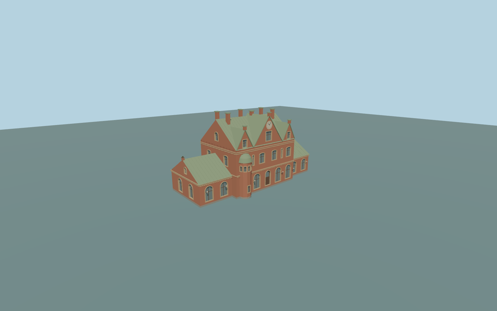

# Umeå Central Station

Complete principal historic Umeå station exterior:both low gabled wings,the full taller central body with three southwest front gables and an original clock face,the negative-X/northwest rounded two-story bay andcurved green roof,closed pale-green copper roof slopes andgable returns,tall brick chimneys/caps,round/segmental-arched ground andupper glazing,closed central/rear doors,original geometric masonry bands/dentils/finials,timber mullions andsmall wall lamps. Hidden northeast/side window inventory is an original medium-fi approximation. Modern platforms/canopies/passages/tracks,streetscape andgreen sculpture remain native;no navigable interior orcopied lettering/ornament.

Rebuild: `node packages/worldgen/scripts/generate-umea-central-station.mjs`;append `--check` for exact source bytes. Select import/LOD/placement with `--ids=umea_central_station`. Detailed source and four browser tiers are separate ignored GLB outputs.

Complete principal historic Umeå station exterior:both low gabled wings,the full taller central body with three southwest front gables and an original clock face,the negative-X/northwest rounded two-story bay andcurved green roof,closed pale-green copper roof slopes andgable returns,tall brick chimneys/caps,round/segmental-arched ground andupper glazing,closed central/rear doors,original geometric masonry bands/dentils/finials,timber mullions andsmall wall lamps. Hidden northeast/side window inventory is an original medium-fi approximation. Modern platforms/canopies/passages/tracks,streetscape andgreen sculpture remain native;no navigable interior orcopied lettering/ornament.

Retained exact way107126501 bounds approximately36.89by14.614m;current principal bounds37.008by14.662m. Native parent height11m controls the central wall,eave11.4m;native wing heights5m control5.2m eaves. Picture-proportioned roof ridges17.5m central and9.3m wings,frontgable peaks15.8/18.2/15.8m,highestcentralcap19.05m,chimneys18.93m androundedbaycap10.35m are approximate visualization controls,not surveyed dimensions. Y=0 uses one exterior entrance sample [0,9],23.28107m;closed occupied support extends to-3m andfloor+.35m. The global field has urban returns;exact historic threshold,platform andstreet grades require actual render inspection.

Two ordinary2021/2025 street-front photographs,current standard PMTiles andtwo unchanged global Terrarium tiles. Observed wings,clock gables,rounded frontbay,roof color andmajor window rhythms are retained. Rear/side hidden inventory,roof joinery,chimney count/placement andfine masonry are inferred medium-fi geometry. Clock hands are original/static,with no real-time claim;ornament/lettering andgreen sculpture are not copied. Exact historic grades,numerical LOD surface errors andphysical-device timings remainunmeasured. No bespoke research.

Seven existing shared256px brick,limestone,granite,copper,wood,painted metal andpunched-window graphs. MetricUVs/linearcolors,no private orembedded images. Skyline retains allwings,gables,clock,roundedbay,roof slopes/chimneys andflat windowpatches inone palettegroup. District addsclosedarch recesses/shallowbands;street addsmodeledframes,seams/lamps;close-up/master refinecurves,mullions andmasonry. Detailedmaster remainsseparate.

Original geometry:repository license. Map:© OpenStreetMap contributors,ODbL-1.0;Protomaps. Standard terrain:terrain-grid.json. Ordinary pictures stay local and are not redistributed or used as textures. Current acceptance:qa.json.
