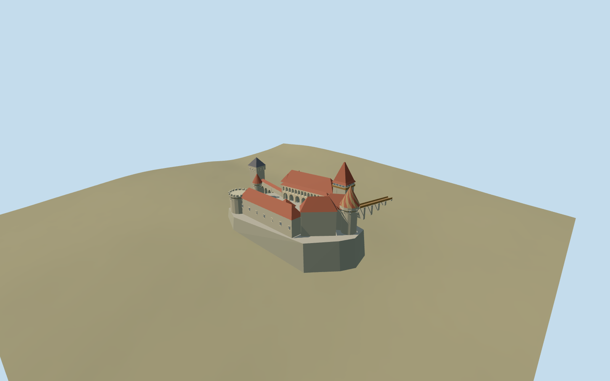

# Corvin Castle

Current Gothic-Renaissance exterior with steep flared gate roof,painted conical tower,four projecting palace oriels,open court loggia,long timber entrance bridge and detached Neboisa tower on a narrow arched gallery.

## Evidence and reconstruction

Published dimensions and reconstructed details are separated in spec.json. Primary references:

- [Reference](https://www.castelulcorvinilor.ro/turul-castelului/)
- [Reference](https://www.castelulcorvinilor.ro/wp-content/uploads/2016/05/home-wine-slide-1.jpg)
- [Reference](https://www.castelulcorvinilor.ro/wp-content/uploads/2016/05/home-wine-slide-2.jpg)
- [Reference](https://www.castelulcorvinilor.ro/wp-content/uploads/2016/05/turnul-de-poarta.jpg)
- [Reference](https://www.castelulcorvinilor.ro/wp-content/uploads/2016/05/curtea-interioara.jpg)
- [Reference](https://www.castelulcorvinilor.ro/wp-content/uploads/2016/05/detalii-de-arhitectura.jpg)
- [Reference](https://www.openstreetmap.org/way/1327914056)

No third-party geometry, photograph or bitmap texture is embedded. Shared surface graphs come from the central library; vertex tints carry model colors. Glazing uses PBR materials; transparent surfaces are declared per model.

## Model and axes

5,936 triangles; 17,808 vertices; 6 material groups; 716,060 bytes. Native bounds: -62.600, -11.237, -94.000 to 65.205, 45.800, 35.190. Source hash: `sha256:27175a017af5e99ded045e07fe522210cf1587612c4d5560a707ac3c02cf5eb6`.

{"up":"+Y","lateral":"+X along cached long axis, toward main northern end","longitudinal":"+Z across courtyard; bridge projects toward -Z","origin":"Site anchor; Y0 standard PMTiles working datum."}

Inspected aerial picture confirms steep red gate roof, patterned round tower, projecting palace oriels, long entrance bridge and detached Neboisa tower/gallery. Retained mapped envelope and standard viewer PMTiles set approximate location, scale and bridge-facing orientation. The working court remains above coarse ground on a bounded reconstructed plinth; bridge deck descends toward the PMTiles approach and pier bottoms extend below terrain. Anchor 22.888262641,45.749130243; heading 0.984834753738; standard PMTiles datum 255.94852799688616m. Floors are reconstructed and foundations extend below the coarse sampled ground.

## Reproduce

Run `node packages/worldgen/scripts/generate-signature-towers.mjs --ids=N0285` (or add `--check`). The generator preserves manually edited masters by checking their baseline hashes. Import through the standard authored-model workflow with optimization disabled; then capture all QA cameras, including shared-surface views.

## Pending work

- Approximate current exterior from one inspected picture and standard viewer PMTiles, without survey accuracy or exact doorway/threshold fit.
- Detailed original architectural master and recipe preserved; derivative reconstructs bounded foundations, a level court and bridge approach.
- Roof pattern, openings, stone plinth and bridge gradient approximate. No interiors, trees, terrain cutouts or exact stream bank/water levels.
- Five shared graphs plus an explicit dark glass slot; zero embedded images. Footprint replacement remains off; physical-device timing unmeasured.

This bundle follows the medium-fi standard. Medium-fi appearance and geographic fit are reviewed separately. Hash-bound visual acceptance is recorded separately after capture inspection.

## Additional geographic data

© OpenStreetMap contributors;Corvin Castle operator primary factual/photo references.
