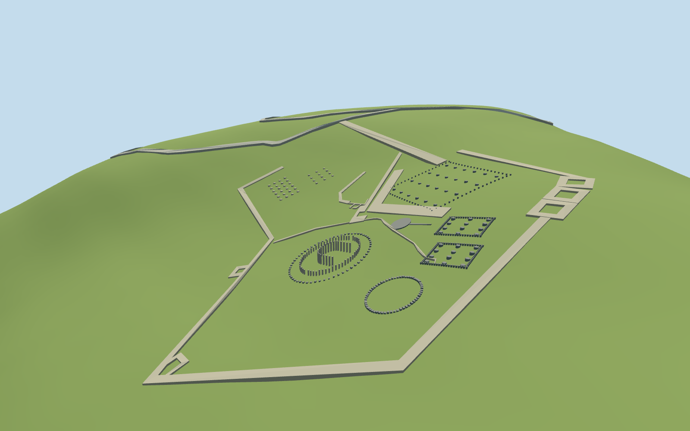

# Sarmizegetusa Regia

Present-day Sarmizegetusa Regia ruins: large circular sanctuary with modern timber reconstruction posts and low stone ring, smaller circular stone sanctuary, solar disc/channel, rectangular limestone/andesite base rows, mapped low terrace ruins and both surviving fortification circuits. No restored ancient roofs, towers or full-height temples. Exact post/base counts, damage, heights and archaeological levels are approximate.

## Evidence and reconstruction

Published dimensions and reconstructed details are separated in spec.json. Primary references:

- [Reference](https://commons.wikimedia.org/wiki/File:Sarmizegetusa_Regia_-_sanctuarul_mare_circular,_panoramă_spre_NE.jpg)
- [Reference](https://commons.wikimedia.org/wiki/File:Sarmizegetusa_Regia_-_panoramă_generală_spre_S.jpg)
- [Reference](https://commons.wikimedia.org/wiki/File:Sarmizegetusa_Regia_2011_-_East_Gate_Wall_Close_Up-1.jpg)

Two registered recipes reconstruct the surviving mapped exterior with shared256² material graphs, metric UVs and linear tints. No embedded images or unique atlas.

## Model and axes

11,030 triangles; 33,090 vertices; 4 material groups; 1,326,576 bytes. Native bounds: -374.095, -57.820, -56.804 to 97.843, 27.429, 438.328. Source hash: `sha256:c2fa9937916f828ba99e98c25a537253d15902d34d864a97ec171374a247d5d6`.

{"x":"east","y":"up","z":"south"}

The geographic proposal uses exact-QID OpenStreetMap evidence. Map-derived orientation and estimated architectural details require real-site visual review; preview eligibility is distinct from geographic/fidelity approval. Map attribution: © OpenStreetMap contributors, ODbL-1.0.

## Reproduce

Run `node packages/worldgen/scripts/generate-additional-landmarks.mjs --ids=sarmizegetusa_regia` (or add `--check`). The generator preserves manually edited masters by checking their baseline hashes. Import through the standard authored-model workflow with optimization disabled; then capture all QA cameras, including shared-surface views.

## Pending work

- Present-day Sarmizegetusa Regia ruins: large circular sanctuary with modern timber reconstruction posts and low stone ring, smaller circular stone sanctuary, solar disc/channel, rectangular limestone/andesite base rows, mapped low terrace ruins and both surviving fortification circuits. No restored ancient roofs, towers or full-height temples. Exact post/base counts, damage, heights and archaeological levels are approximate.
- Q739802 identifies the Dacian settlement. The retained standard PMTiles distinguishes named circular/limestone/andesite sanctuaries, solar-disc geometry, low wall traces and fortification footprints. The old catalog axis describes the fortress, not a temple facade. Geometry keeps raw east/south coordinates and heading0; mapped rectangle edges provide the rectangular sanctuary axes. Modern ticket/ranger structures remain independent.
- Ordinary pictures guide low surviving stonework, roughly1.5–4m modern timber posts,0.3–0.8m stone bases and approximately1.65m fort wall remains. These are visual proportions; map heights are absent. Exact ancient elevations are not reconstructed.
- Reviewed approximate fit on the retained unchanged161-square/6m standard DEM. Low wall crests, stone bases and timber-post foundations follow local terrain samples, with buried sides below grade. The planar solar slab is conservatively above its sampled coarse-terrain envelope after its initial half-buried draft was corrected; its exact ancient threshold is not claimed. No ground or water cutout.24 mapped ancient records are replaced to numerical boundary remnants below1e-7m² per record, preserving both open fort interiors and both independent modern ticket/ranger buildings byte-for-byte. Failed loading restores all26 native map records; eviction releases geometry. The source-local PNG is a16-bit encoding of this same retained grid for visual review, not a new terrain survey.
- Modern timber posts show the present-day sanctuary reconstruction, not surviving ancient wood. Shared vertical weathered-wood material is a visual approximation. Exact stone/post counts and damage are not a surveyed inventory.

This bundle follows the medium-fi standard. Medium-fi appearance and geographic fit are reviewed separately. Hash-bound visual acceptance is recorded separately after capture inspection.

## Additional geographic data

©OpenStreetMap contributors; Protomaps; Mapzen/USGS terrain.
