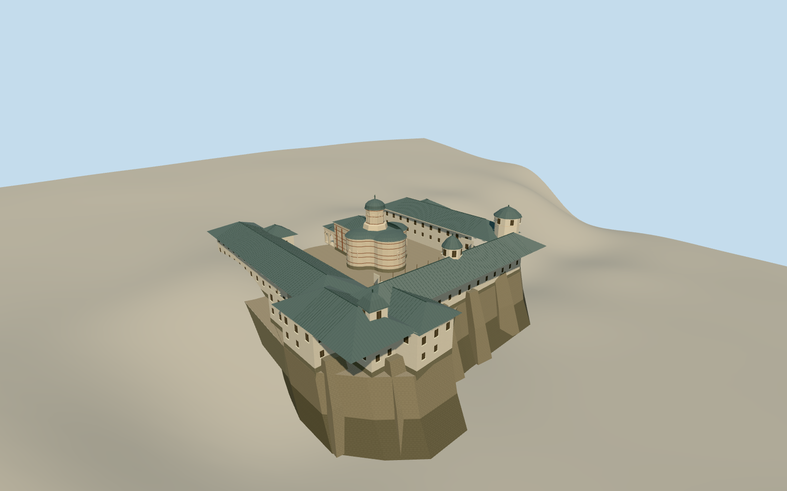

# Cozia Monastery

Cozia Monastery above the Olt, with a trilobed stone church, tall drum, pale monastic wings, gray-green roofs and riverbank buttresses as documented in 2009.

Authoring state: **review-in-qa.json**. Current completion evidence is in [qa.json](qa.json) and the [completion ledger](../../../../qualla-structures/batches/qualla-003.PROGRESS.md).

- [Cozia Monastery](https://qualla.com/cozia-monastery/)

Model covers the principal church and contiguous monastery ranges on the Olt riverbank as seen in November 2009. It includes the main retained court and river supports.

Native church, range and round tower map outlines fix the plan. The church booklet fixes the drum section and the surviving images fix the silhouette. Roof junctions, parapet details, window spacing and repeating ornament are estimates.

The unmodified public terrain shows a submerged or generalized riverbank surface below the visible monastery court. Model retaining walls support the occupied level above that surface. Foundation toe and absolute grade are approximate.

Build: `node content/worldgen/source/places/u8/u81/cozia_monastery/models/generate-cozia-monastery.mjs`. Add `--check` to verify exact regeneration. 17844 triangles; 6 materials; no embedded photographs.
