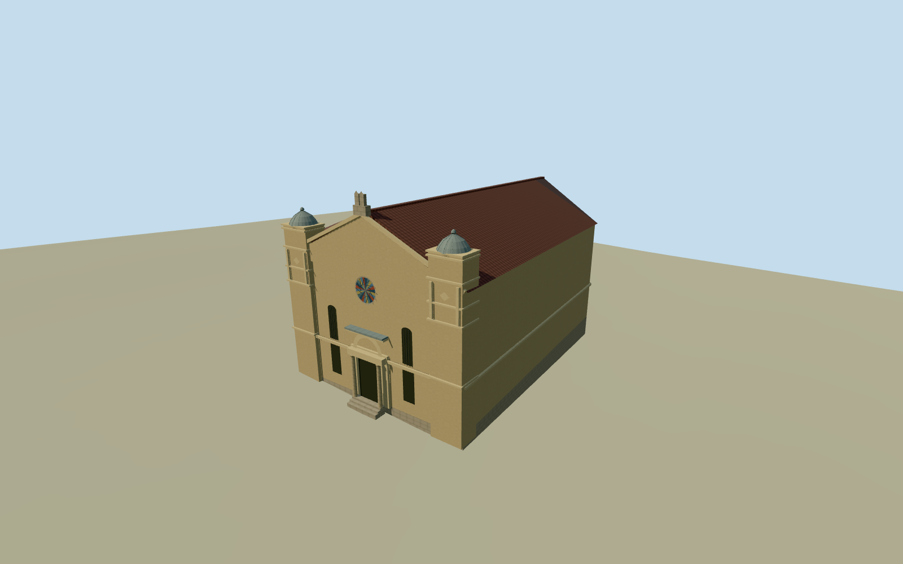

# Northern Transylvania Holocaust Memorial Museum

Restored 1876 synagogue with pale ochre frontage, paired silver domes, round stained glass and the recessed portal.

Authoring state: **review-in-qa.json**. Current completion evidence is in [qa.json](qa.json) and the [completion ledger](../../../../qualla-structures/batches/qualla-004.PROGRESS.md).

- [Northern Transylvania Holocaust Memorial Museum](https://qualla.com/northern-transylvania-holocaust-memorial-museum/)

Models the standing restored synagogue exterior. Other museum exhibits and adjacent buildings are outside scope.

The entrance elevation follows the original photo. Side and rear opening placement, small ornaments and heights are estimates.

Build: `node content/worldgen/source/places/u8/u82/northern_transylvania_holocaust_memorial_museum/models/generate-northern-transylvania-holocaust-memorial-museum.mjs`. Add `--check` to verify exact regeneration. 2973 triangles; 6 materials; no embedded photographs.
