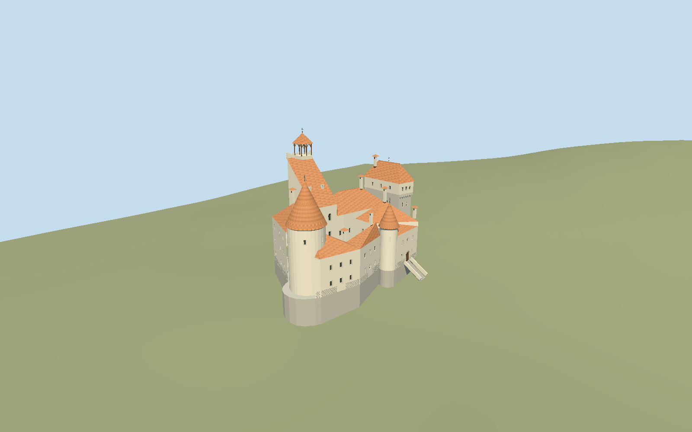

# Bran Castle

Asymmetric Transylvanian castle with mapped open courtyard, round western tower, steep single-slope keep roof, scalloped rear parapet and timber belfry, projecting eastern tower chamber, south stair turret, arched galleries, well and entrance stairs.

## Evidence and reconstruction

Published dimensions and reconstructed details are separated in spec.json. Primary references:

- [Reference](https://bran-castle.com/pages/historical-chronology)
- [Reference](https://bran-castle.com/pages/bran-fortress)
- [Reference](https://bran-castle.com/pages/visitor-map)
- [Reference](https://www.openstreetmap.org/relation/3300200)
- [Reference](https://commons.wikimedia.org/wiki/File:Bran_Castle,_Transylvania_(2023).jpg)
- [Reference](https://commons.wikimedia.org/wiki/File:Bran_castle_courtyard.jpg)
- [Reference](https://commons.wikimedia.org/wiki/File:Bran_castle_courtyard_round_tower.jpg)

No third-party geometry, photograph or bitmap texture is embedded. Shared surface graphs come from the central library; vertex tints carry model colors. Glazing uses PBR materials; transparent surfaces are declared per model.

## Model and axes

33,258 triangles; 68,284 vertices; 7 material groups; 2,861,556 bytes. Native bounds: -23.846, -7.173, -14.050 to 24.381, 40.249, 18.009. Source hash: `sha256:b25949c6ee650d1837c75839acf40e8acf4768811d0555b38d3d471b0de1ea11`.

{"up":"+Y","longitudinal":"+X 39.51 degrees south of east","front":"+Z southwest","origin":"Retained signed castle anchor; Y0 decoded 764.9841 m numeric working datum."}

Fresh exact-Q390275 relation 3300200 v30 and seven outer, court and roof/tower ways match retained coordinates within 0.672 mm. Native +X southeast at 129.515 degrees, +Z southwest at 219.515 degrees. Round western tower, northeast keep/belfry, eastern tower and southwest stair/entrance sign the frame. Retained Terrarium public numeric terrain and a 4225-value 4 m native grid establish contact against one viewer terrain product. Y0 is the decoded 764.9841 m anchor working datum; no regional survey or ellipsoid conversion is asserted. Reconstructed courtyard floor 3.849 m above that datum uses highest mapped outer-boundary sample plus 0.25 m. Architecture receives one rigid -0.151 m translation from the original court basis; footprints and vertical proportions remain intact. Occupied perimeter feet extend 4 m below sampled terrain, court paving stays a thin architectural slab, and host terrain supplies the geological knoll. Whole-precinct replacement/cutout remains disabled. Coarse terrain cannot establish precise cliff or architectural elevations; local Romanian public terrain service was unreachable.

## Reproduce

Run `node packages/worldgen/scripts/generate-signature-towers.mjs --ids=bran_castle` (or add `--check`). The generator preserves manually edited masters by checking their baseline hashes. Import through the standard authored-model workflow with optimization disabled; then capture all QA cameras, including shared-surface views.

## Pending work

- Original 145600-triangle / 13770396-byte master remains preserved and reproducible at sha256:1d40b097ab6f1765fa729f7b06db09811704bac68fee1c3ed384422ff4987bff from bran-castle-model.mjs#branStudy.build. Independent medium-fi derivative retains the exterior while replacing the provisional four-meter rock contact with mapped feet and an explicit relative terrain reference.
- Fresh exact-Q390275 relation 3300200 v30 and seven outer, court and roof/tower ways match retained coordinates within 0.672 mm. Native +X southeast at 129.515 degrees, +Z southwest at 219.515 degrees. Round western tower, northeast keep/belfry, eastern tower and southwest stair/entrance sign the frame. Retained Terrarium public numeric terrain and a 4225-value 4 m native grid establish contact against one viewer terrain product. Y0 is the decoded 764.9841 m anchor working datum; no regional survey or ellipsoid conversion is asserted. Reconstructed courtyard floor 3.849 m above that datum uses highest mapped outer-boundary sample plus 0.25 m. Architecture receives one rigid -0.151 m translation from the original court basis; footprints and vertical proportions remain intact. Occupied perimeter feet extend 4 m below sampled terrain, court paving stays a thin architectural slab, and host terrain supplies the geological knoll. Whole-precinct replacement/cutout remains disabled. Coarse terrain cannot establish precise cliff or architectural elevations; local Romanian public terrain service was unreachable.
- OSM height tags 50–73 m have unresolved datum and are not facade survey heights. Keep roof, belfry, tower eaves, scallops and roof valley heights retain photograph-derived relative proportions.
- Terrarium tile pixels and 4 m native review samples are not source DEM resolution or vertical accuracy. Small cliff, steps and under-building ground can be smoothed or contaminated; no local LiDAR accuracy, current terrain vintage or universal host compatibility claim.
- Shared granite, limestone, plaster, timber, ceramic and painted-metal graphs; recesses share tinted plaster. Local opaque PBR glass and baked common skyline means avoid embedded images. Fine weathering and distinctive rounded tile ends are simplified.
- Current exterior/courtyard reconstruction excludes interior rooms, artwork, furniture, underground Time Tunnel, temporary visitor equipment, surrounding park/forest and village. Courtyard masonry, gallery, well ironwork and window locations remain photograph-guided approximations. Physical phone/laptop timings remain unmeasured.

This bundle follows the medium-fi standard. Medium-fi appearance and geographic fit are reviewed separately. Hash-bound visual acceptance is recorded separately after capture inspection.

## Additional geographic data

Map geometry © OpenStreetMap contributors, ODbL-1.0. Photographs and official visitor map are references only; no pixels or third-party mesh copied.
