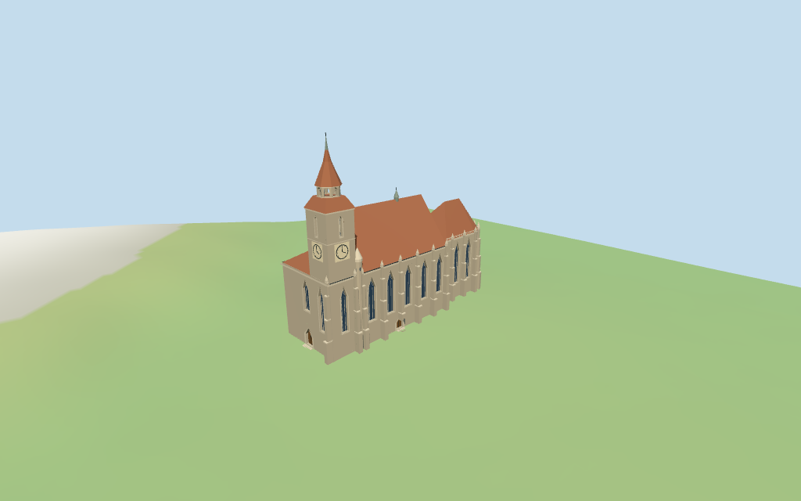

# N0362 — Black Church review

Reviewed 2026-10-15 against current source/runtime bytes. Accepted for the medium-fi exterior and approximate geographic/terrain scope.

## Built result

Inspected all 11 current portable/source-terrain frames. Individual Brasov Black Church: long gray-tan Gothic hall, very steep broad red-brown tiled nave roof, lower polygonal east choir roof and lower west corner roof; single southwest square clock tower with two simplified clocks, narrow upper slits, layered tile hip, open octagonal crown gallery, tall tile spire and metal tip. Tall pointed window/door fields have deep reveals and closed glazing/wood backing, sparse mullions/tracery and pale stone surrounds. Stepped buttresses/pinnacles, circular choir parapet band, small south stair turret and ridge fleche carry the close silhouette. Corrected inward-wound profile faces on the tower hip, spire and pinnacles; direct outward-surface probes now cover those surfaces in every output. Exact painted clock mural/numerals, stone figures and inscriptions omitted.

Medium-fi exterior from three useful exterior pictures plus standard viewer PMTiles/DEM only. Main footprint/orientation and approximate 41/37m roof tags retained. Single clock tower/crown subdivisions, 65m finial, lower west roof, stair turret, fleche, windows/portal/buttress rhythm, tiny tracery and thresholds are picture-led estimates rather than survey dimensions. Clock face is a simplified geometric disk/hands; painted mural/numerals, exact sculpture/inscriptions, surrounding landscaping/town, interiors and certified walking excluded. Physical laptop/phone timings pending.

## Shared materials and placement

Inspected all 11 current shared-material/placement frames. Five existing 256-square ashlar, limestone, flat tile, plain wood and standing-seam metal graphs serve eight groups. Gray-tan stone, pale trim, red-brown tile and gray-green metal use linear tints and metric UVs. Glass, simplified clock and accents use flat PBR colors. Zero embedded images, bespoke facade textures or baked soot/weathering/shadows. Each graph reads once; unload disposes model geometry, leaves zero live model geometries and restores ground. Flat geographic placement confirms plan/orientation; source-terrain views show the approximate foundations/entries. Ground colors are diagnostic.

Retained exact-QID way866090450/Q910124 matches current main35185238179282 and three nave/choir/apse parts. Four current raw plans/tags/min_height absences retained without rescale. Anchor[25.588207851,45.641023332], heading0.3169818482414655rad follows the longest current nave edge, signed by the western facade/southwest tower and eastern choir. Retained0.318938020587rad axis differs by 0.112deg. Current 41m nave and 37m choir/apse tags are approximate full roof envelopes, not stacked wall solids. Picture-led eaves 24m and tower subdivisions culminate in 65m finial guided by a retained unqualified Wikidata claim; 89x38m length/width claims do not rescale the 81.4x26.1m mapped envelope. Recorded plan clips reproduce; all 48 actual viewer footprint checks cover four controls while preserving three unrelated neighboring buildings and a west-front patch across six outputs. Standard DEM datum 597.075184m, display offset 0.4m, perimeter -1.46..-0.17m; foundations follow terrain and entries use local DEM + 0.22m with estimated short steps. Exact paving/thresholds, absolute altitude and certified walking unverified. No road replacement or terrain flattening.

Inspected all 27 current Earth-lighting frames: Economy/High, noon/late, three distances, silhouette, six detail crops, four matched whole-model levels and four transitions. Skyline keeps the long hall, steep roof hierarchy, southwest clock tower/crown, lower west corner, polygonal choir and coarse buttresses. District adds shared textures, flat pointed glazing/doors, simplified clocks and genuinely open gallery arches. Street adds facade/entry recesses, stepped buttresses/pinnacles, sparse mullions and choir parapet rings. Closeup/master refine facets/tracery. Whole-model levels retain the complete church; detail crops intentionally show a portion. Synthetic Swedish-cottage neighbors and terrain bands are diagnostic rather than mapped Brasov surroundings.

## Browser budgets

| Level | Triangles | Bytes | Draws |
| --- | ---: | ---: | ---: |
| skyline | 718 | 65968 | 1 |
| district | 3322 | 280988 | 7 |
| street | 12876 | 1194784 | 7 |
| closeup | 16776 | 1557996 | 7 |

Initial skyline plus district: **346956 bytes** of geometry. Master: **2017224 bytes /16776 triangles**. Five cached shared 256² graphs; zero embedded images. Initial geometry excludes graph definitions/texture generation. Split POSITION/NORMAL streams with equal CPU/GPU totals. Physical device timings pending.

## Verification

- Targeted generation byte reproduction, source/import/LOD/input/review hashes, recipe index and source inventory/schema match.
- Six Khronos validations: zero errors/warnings/images; four browser budgets pass.
- Four raw map controls, signed frame, recorded plan clips, raw height tags and retained standard DEM match.
- **602 imported geometry probes** and **48 actual viewer footprint checks** pass.
- Shared graph read-once/unload and hash-bound placement/medium-fi reviews pass.
- Scene validation and 30-tick simulation pass. Simulation hash: sha256:a07f89afa94daa252e9643e6f7f1d97f9f2651ee19b1b5cb2a485bbc70b7bc11.
- Inspected **49 current frames**: 11 portable, 11 shared/placement, 27 medium-fi. Reports retain cameras/paths/hashes; bulk images stay ignored.

Source hash:sha256:adcce469a81653595e082e5788694f979da432b27cbd76d7e0ef9500b3e60b59. Runtime hash:sha256:d9f04ec27f8ee1f4b2ee70d17382502d9a1a80fbaee8e5b2c9bddd49aa436915. Input hash:sha256:ffb998eb0d3ca56e9726b38634d24ef71e6555ae679bdd13d7652ebc812ef2e1.

Commands: targeted generate/import/LOD/register-landmark-previews --ids=N0362; generate-additional-landmarks.mjs --ids=N0362 --check; capture-next-1000-models.mjs --ids=N0362 --reflections --antialias --fit-shadows; capture-landmark-library.mjs --ids=N0362 --reflections --adaptive-clipping --bounded-placement; capture-medium-fi.mjs --ids=n0362_black_church --reflections; molen validate; molen sim run --ticks 30 --hash. Next full source checkpoint covers N0360–N0379.

## Limits

- Retained exact-QID OSMway866090450/Q910124 matches current main35185238179282. Current nave part35185238179280 is41m; choir and apse parts35185238179279/278 are37m, with no min_height. Treat these as approximate complete roof envelopes, not stacked solids: estimated nave eave24m/ridge41m and choir eave24m/ridge37m. Retained unqualified65m Wikidata height guides the single clock tower and finial; its masonry44.5m/crown subdivisions are picture estimates. Retained89m length/38m width claims are not used to rescale the unscaled81.4x26.1m mapped church footprint.
- Standard DEM datum597.075184m; display datum offset0.4m, perimeter terrain-1.46..-0.17m. Foundations follow terrain; approximate west/south thresholds use local DEM+0.22m with short steps. Coarse DEM does not certify absolute altitude, precise paving/steps, doorway thresholds, cut/fill, interiors or walking. No global terrain flattening.
- Medium-fi exterior from three useful pictures and standard viewer PMTiles/DEM. Exact clock mural/numerals, stone sculpture/inscriptions, tiny tracery/portal details, surrounding trees/town, interiors and certified walking excluded. Tower/stair/fleche divisions, facade rhythm and buttress widths are approximate; physical device timing pending.
- Skyline preserves the individual roof/tower profile and coarse buttresses. District adds shared textures, flat pointed glazing/doors, clocks and genuinely open crown gallery. Street adds facade/door recesses, stepped buttresses/pinnacles, restrained mullions/tracery and parapet rings. Closeup/master refine arch/ring facets. Synthetic context neighbors are not mapped Brasov buildings.

Readiness accepts this exterior scope. The 1,000-candidate goal remains incomplete.
